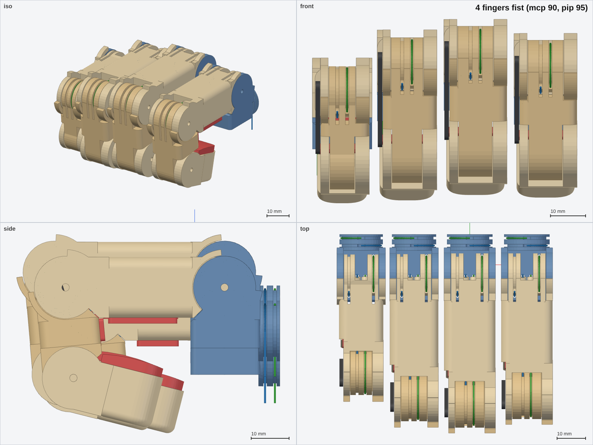
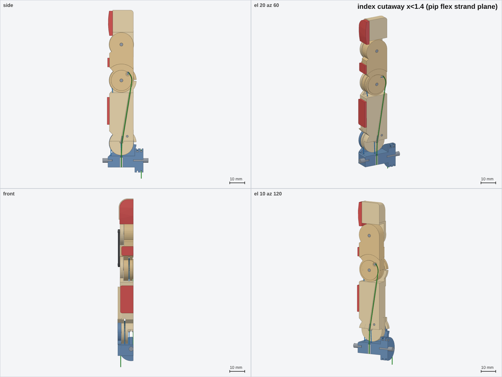

# 01 · Finger module (index, middle, ring, little)

Study 2026-11-09, V2 concept hand. Code: `cad/finger.py` (one parametric module, sizes from
`params.FINGERS`). Outputs: `out/finger/<finger>/` (STEP assembly + one STL per part + a JSON with the
joints, strands and interface), renders `out/finger/*.png`, all check numbers in `out/finger/summary.json`.

```
uv run --no-project --with cadquery --with trimesh --with numpy --with matplotlib --with scipy \
       --with pillow --with rtree python cad/finger.py            # all 4 fingers, ~3 min
       [--finger index] [--quick] [--no-export] [--no-render] [--no-collide]
```

## 1. What it is



| | |
|---|---|
| Joints | `mcp_abd` (axis +Y, **11.5 mm below** the MCP flex axis), `mcp_flex`, `pip` (axes +X), `dip` (+X, no servo, bar-coupled) |
| Ranges | params: abd ±15°, mcp −10…90°, pip −5…95°; DIP follows: −3.2…70.9° |
| Drums | **R = 7.0 mm on all three servo joints** (abd, mcp, pip), all fingers incl. little → 0.1222 mm/°, servo ratio 1.4 everywhere |
| Parts per finger | yoke, proximal, middle, distal (PETG); tip / proximal / middle pads (TPU 95A); bar (stainless 1.2 × 3.2, or PETG for a first print); 2 mm dowels (MCP stubs ×2, PIP, DIP); 3 mm dowels (abd ×2); 1.5 mm posts (abd, mcp, pip anchors) and link pins (×2); 2 × 18G stainless eyelets; 4 PTFE sheath ends |
| Printed volume (index) | yoke 4.3, proximal 10.6, middle 6.1, distal 4.6 cm³ (PETG ≈ 32 g with 100 % infill) |
| Validity | every solid valid + watertight: 24/24 (little 23/23, its middle is too short for a middle pad) |

### Layout across the finger (index, x = finger-local, + = thumb side)

```
 x:   -9 ......... -4.3 ... -2.2  -1.4  0  +1.4  +2.2 ... +4.3 ......... +9
MCP:  cheek(yoke) | mcp FLEX groove | slot: pip flex, pip ext strands + eyelets | mcp EXT groove | cheek
      stub axle 2 mm from |x| = 2.65 outward (the centre stays free for the crossing strands)
PIP:  cheek(prox)  |        pip FLEX groove -1.4   pip EXT groove +1.4        | cheek   (through pin)
DIP:  cheek(dist)  |                 middle-phalanx tongue                    | cheek   (through pin)
      bar on the -x face, in a 1.6 mm recess (stays inside the 18 mm width)
```

## 2. Tendon routing and why

**Every servo joint = one loop on a true circle centred on its axis.** The flex strand wraps one groove and
the extend strand another. Each ends on a **1.5 mm steel post whose top is flush with the groove floor**
(post centre at r 6.07). The strand runs off the drum onto the post in the same bending direction, so
there is **no reverse bend at the anchor**. It then wraps the post 1–1.5 times and is knotted in a
Ø2.9 mm pocket. In the printed part the anchor only ever sees the capstan-reduced tension. Assembly: tie a
loop, drop it into the pocket, push the post through from the side face (the cheeks then keep it in).

Wrap margins at the range ends (contact arc beyond the tangent point): MCP flex 40°, ext 40°; PIP flex
≥ 48°, ext ≥ 33°; abd 75°. Anchors: MCP at 50° and PIP at 45° (measured from +y, dorsal-distal), abd at the
top of its disc. Result in the check table: **own-joint slope exactly ±0.1222 mm/°, non-linearity 0.0000 mm,
flex + ext sum constant to 0.0000 mm** (constant mm per degree, no slack, no over-tension).

**Abduction is crossed in Bowden sheaths (exact).** The four mcp_flex and pip strands arrive in PTFE
1 × 2 sheaths that are clamped in the yoke (2.2 bore, tube stop at z −9.5, 1.2 bore to the top face). Once
both sheath ends are fixed (here, and at the servo end in the forearm), abduction and the wrist only bend
the free sheath, and the strand inside cannot change length. That is the 1X/Halodi and Optimus V3 recipe:
"braided polymer cables in lined tubes". The free span below the yoke is 22 mm. Its smallest bend radius
over ±15° abd is **19.1 mm** (≥ 15 ✓). The abd drum's own two strands go down to sheath mouths fixed in
the palm.

**The pip strands cross the MCP flexion axis bare, through a steel eyelet.** I analysed three options numerically (scratch
studies, then the same maths in `crossing_length()`):

| Option | Strand length change over MCP −10…90° | Verdict |
|---|---|---|
| Sheath across the MCP | not possible: 90° at R ≥ 15 mm needs ~24 mm of free sheath outside a 16 mm finger | ✗ |
| Idler pulley on the axis (flex one side, ext other) | pip turns 0.17° per MCP° (1.85 mm at 90°): a coupling the firmware must undo | ✗ (brief) |
| Bare crossing, guide tangent *at* the axis (V1 style, 1 mm fillet) | −0.51 mm | ✗ |
| Guide pins just distal of the axis, but clear of a 2 mm axle | 0.9–1.0 mm | ✗ |
| **18G stainless eyelet (ID 0.84, rim r 0.25) along each strand, mouth 0.2 mm *proximal* of the axis** | **0.19 mm peak-to-peak (flex), 0.11–0.13 (ext)** | ✓ chosen |

The optimum (searched per finger) puts the guide edge slightly before the axis. Small q then costs a
little length and large q gives it back. The bend at the axis always happens on **polished steel**. The
eyelet is pushed into its bore from the open slot below the axis, so it needs no X-direction hole and the
MCP can still run on steel stub axles. Both pip strands change by nearly the same amount, so **the PIP
angle error from MCP motion is < 0.3°**: the residual is loop slack, not coupling.

The pip strands then run straight from the eyelet to the PIP drum's tangent points, with no further
contact. They go diagonally inside the proximal phalanx (flex to the palm side, ext to the back), each in
a 1.2 mm bore in its own x-plane.

## 3. Decoupling check (all four fingers)

Length change (mm) of each strand while each *other* joint sweeps its whole range, worst case with the
third joint at min/0/max (`decoupling()`). Target < 0.2 mm (≈ 1.6° at 7 mm).

| strand | Δ / abd | Δ / mcp | Δ / pip | own mm/° | loop-sum var |
|---|---|---|---|---|---|
| abd flex/ext | own | 0.000 | 0.000 | ∓0.1222 | 0.000 |
| mcp flex/ext | 0.000 | own | 0.000 | ∓0.1222 | 0.000 |
| pip flex (index / middle / ring / little) | 0.000 | **0.192 / 0.186 / 0.189 / 0.193** | own | −0.1222 | 0.000 |
| pip ext (index / middle / ring / little) | 0.000 | 0.128 / 0.113 / 0.114 / 0.131 | own | +0.1222 | 0.000 |

Analytic lengths match the 3D polylines exported in `strands` to 0.002 mm. The 0.000 rows hold by
construction (sheaths, and strands that start and end in the same pair of bodies). They are listed so the
integrator can see nothing else couples. One honest caveat: the 0.19 mm assumes the strand sits on the
eyelet rim as modelled. Rim radius and eyelet height tolerance matter (a 0.2 mm height error adds
≈ 0.05 mm). The bench test in §7 should measure it.

## 4. DIP coupling bar

`dip_linkage.design()` (V1 maths, read-only import) on my middle lengths, bar outside the side face in a
1.6 mm recess:

| finger | bar | pin A (prox, r @ angle) | pin B (distal) | max \|DIP − 0.75·PIP\| | min transmission |
|---|---|---|---|---|---|
| index | 22.87 | 3.50 @ 33.8° | 4.49 @ −78.7° | 0.51° | 39° |
| middle | 25.92 | 3.50 @ 37.9° | 4.51 @ −79.4° | 0.44° | 36° |
| ring | 24.93 | 3.50 @ 35.6° | 4.50 @ −78.0° | 0.48° | 38° |
| little | 18.71 | 3.50 @ 30.1° | 4.50 @ −81.3° | 0.52° | 39° |

No toggle, transmission ≥ 36° (rule 30–150°). In `build()` the DIP angle is the exact circle–circle
solution, not the fit. With 1.5 mm pins in 1.6 mm bar holes the DIP has ≈ 0.6° of backlash. A 1.2 mm
stainless bar does not buckle (Euler ≈ 1 kN against ≈ 35 N of bar load); a PETG bar (≈ 40 N) is marginal,
so it is for a first print only.

## 5. Collisions, stops, strand clearance

- **Interference** (OCC boolean, > 0.05 mm³) for every pair of parts, including the bar, pins, eyelets
  and PTFE. Poses: mcp {−10, 40, 90} × pip {−5, 45, 95} at abd 0, plus (abd 15, mcp 90, pip 95). **All 40
  finger-poses are clear** (`summary.json` → `collisions`).
- **Strands vs solids:** every bare strand sampled every 0.3 mm at open, mid and fist: **no point is inside
  a solid.** Two cases needed fixes: the flex strands at full flexion pass through the root of the next
  phalanx, so the 1 mm groove slots go out to r 12 (MCP) and r 11 (PIP).
- **Hard stops** sit **1° past each servo limit**, from "stop windows" cut around each joint:
  - Flexion: the child's palmar heel lands on the parent's palmar face.
  - Extension: dorsal lugs on the cheeks meet dorsal heels on the child.
  - This puts the stops at mcp −11/+91° and pip −6/+96°. The DIP is limited by the bar and never reaches
    its window.
  - The servo can stall against a stop (useful for ORCA-style self-calibration) without the strand doing
    the stopping.
- **Knuckle shape:** round knuckles of r 8 (r 7.6 on the little finger) form the drums. A dorsal
  prominence comes from the stop lugs. The proximal and middle phalanges have flat palmar TPU pads 1.5 mm
  thick. The tip pad is 3 mm thick, flattened (R 45), and protrudes 0.8 mm below the outline.



## 6. Interface for the palm (hand frame, from `build(name)["interface"]`)

Per finger (index numbers; the others are in their JSON):

| Item | Value |
|---|---|
| Abd axis | point (20, −4, 80.5) = MCP − 11.5 z, dir +Y; **two coaxial 3 mm dowels** |
| Palm holds the pins at | y −16.5…−13.25 (palmar) and +10.85…+14.0 (dorsal, hand y); the yoke runs on them between |
| Yoke envelope over abd ±15° (+0.25) | x 5.94…34.06, y −13.25…10.85, z 70.2…102.2. **Keep it clear** |
| Sheath exits (yoke bottom, z 76, dir −Z, move with abd) | mcp flex (15.7, −11.0), mcp ext (24.3, 3.0), pip flex (18.6, −4.0), pip ext (21.4, −4.0) |
| Palm sheath guides (fixed) | same x, y at z 54.0, dir −Z (22 mm free span; channels below may curve with R ≥ 15) |
| Abd strands (palm sheath mouths, fixed) | flex (27.0, 6.7, 68.5), ext (13.0, 9.3, 68.5), dir −Z |

Sheath order at the yoke bottom is palm → back: mcp flex, pip flex/ext, mcp ext (the drums' tangent
sides). For the forearm: 24 finger strands, all on 7 mm drums with 5 mm spools (ratio 1.4).

## 7. Force, failure modes, mitigations

**Fingertip force** (straight finger, MCP-limited, 90 % efficiency, lever to the pad centre):
- **SCS0009:** strand 45 N → **0.29 N·m at the MCP** → **3.4 N** tip (index), 4.0 N (little).
- **HLS3606M:** 118 N → 0.74 N·m → **8.7 N** (index).

The common 7 mm drum costs ~7 % against V1's idea of 7.5 mm at the MCP. I kept 7 mm as the brief asks
(owner's "same distance on each degree"). A bigger MCP drum would be the cheapest strength upgrade (see
requests).

| What fails first | Why | Mitigation in this design |
|---|---|---|
| Strand at the MCP eyelet rim (fist, full load) | 90° bend over r 0.43 (D/d ≈ 2.4) under up to 118 N | polished, flared 18G rim; 80 lb braid on HLS joints; cap the HLS torque at ~60 % (README §2); the bend is only at large MCP angles |
| Knot / anchor | concentrated load | flush post, no reverse bend, 1–1.5 wraps → knot sees ≈ 25 % of tension |
| MCP stub axles in PETG | 2 mm pin, 3.85 mm bearing length per side: ≈ 6 MPa at 45 N strand load, ≈ 15 MPa with HLS | OK for SCS0009; for HLS use a brass sleeve or ream for a 2.5 mm pin (room exists: stubs start at \|x\| 2.65) |
| Print layers | cheeks and arms are loaded across layers if printed upright | print phalanges **on their side** (x-normal): drums, grooves and all strand bores lie in the print plane, and cheeks are in-plane |
| Abd overload (finger hit sideways) | 3 mm pins, long lever | the pins are 23 mm apart (stiff); a pop-out seat (ORCA/PSYONIC) on the palm side is a cheap V2.1 upgrade (open issue) |
| Sheath end pumping | loose clamps add hysteresis | tube stop + 2.2 bore; glue or a set screw recommended |
| Pretension creep | stiff braid: 0.1 mm = 2–3 N | split spool at the servo (forearm module); the 0.19 mm loop-slack residual from the MCP crossing is within a soft extensor spring's range |

## 8. Ideas taken from the research

- **1X / Halodi:** one motor per joint with two opposite strands, polymer tendons in tubes; a sheath from
  the forearm to the finger base makes the wrist and abduction transparent.
- **Optimus V3 (patent):** braided polymer in lined tubes; tendons cross a joint where their moment arm
  is ~0 (their wrist router; here the MCP eyelet at the axis). Rejected: springs for extension (we keep the
  antagonistic loop, which is stiffer and can push) and rolling contact (Musk: "didn't actually work").
- **Shadow:** the agonist–antagonist pair on one spool and DIP–PIP coupling; Spectra (UHMWPE) tendons.
- **ORCA:** DIP rigidly coupled, steel pins at contact points, hard stops for self-calibration. Not yet
  taken: pop-out joints.
- **Figure 03 / research README:** soft, flattened fingertip pads (~3× less pinch force needed) and
  palmar phalanx pads.
- **V1:** pass-through strands on the axis and the DIP bar maths; improved here with a steel eyelet,
  optimised height, stub axles and posts instead of tie holes.

## 9. Requested params changes

1. `ABD_OFFSET_DEFAULT = 11.5` (was 10). Below 11 mm the palmar abd pivot boss hits the proximal phalanx at
   90° flexion. With the pivot moved out of the palm side it could be ~9.
2. **The finger MCP y = −4 puts the palmar abd pin outside the palm** (it needs palm material at hand y
   −16.5…−13.25, the palm face is −14). Either let the palm bulge 2.5 mm at the knuckle row (like the human
   MCP pads) or move the finger MCPs to y = −2.
3. Add a knuckle width: the MCP knuckle is `max(W, 17)` mm (the little finger's is 17, not 15.5) so the
   MCP drum keeps 1.2 mm flanges.
4. Abduction spacing: the yoke envelopes of neighbouring fingers overlap when they abduct *toward each
   other* (index envelope reaches x 5.9 and the middle's reaches +14). Either limit that combination in
   software (as humans: adduction ends when fingers touch) or increase the MCP spacing to ~21 mm. I
   recommend the software limit.
5. Optional strength: `R_DRUM_MCP = 8` (servo ratio 1.6 at the MCP only, +14 % tip force). This breaks
   "one radius everywhere", so it is the owner's call; the drum fits (knuckle r 8.6 → 17.2 mm tall).

## 10. Open issues (honest)

- **Not built or printed.** The eyelet rim geometry is modelled as two lips. The real 0.19 mm needs a
  bench test: pull the pip loop through MCP sweeps and measure its length with a dial gauge.
- The strand twists only at the anchors; its fleet angle into the grooves is 0° by construction. Not checked: the
  braid's bending fatigue over the r 0.43 rim (D/d 2.4). A cycle test (10 k fists) is the first thing to run.
- The fingertip TPU pad is a simple flattened block; a nicer human pad (a loft) and a magnet/Hall pocket
  for tactile sensing are not modelled.
- The pip strands in the proximal run in plain 1.2 mm PETG bores. They are straight with no contact in
  theory, but a PTFE liner would protect against misalignment.
- Collisions with the **palm and neighbouring fingers** are not checked here (the integrator's job), apart from
  the envelope above.
- The distal tip's dorsal fillet may silently fail on some sizes (it is wrapped in try/except). The solids
  stay valid; only the nail edge is sharper.
