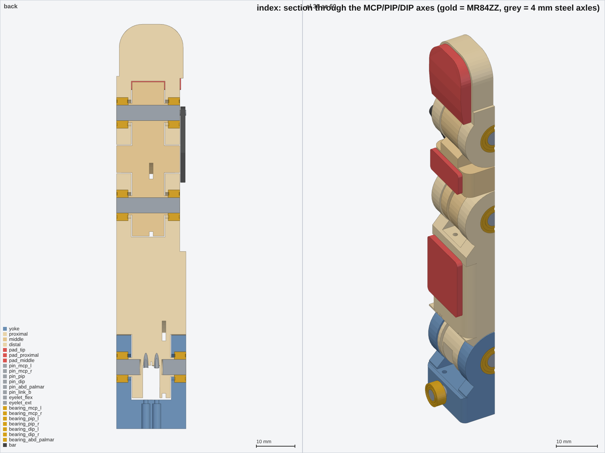
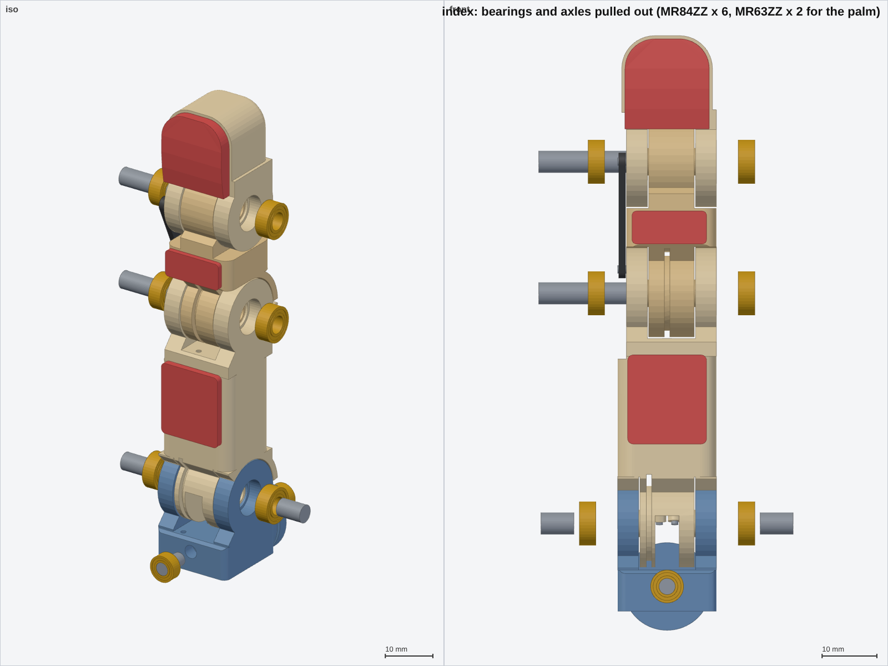

# 06 · Bearings in every hinge and the owner's one-track tendon (fingers)

Finger designer, 2026-11-13. Owner's request: "2 bearings per joint, on each side, 4x8x3 … one track per
joint like mine: one tendon, a hole at the top of the track ring, I knot it there and the motor can drag
both ways … make it possible to remove and add them for me to see."

Code: `cad/finger.py` (all four fingers). Outputs: `out/finger/<finger>/` (STEP + STL per part + JSON),
renders `out/finger/*_bearing_section.png`, `*_exploded.png`, `*_with_bearings.png` / `*_no_bearings.png`,
`*_{mcp,pip}_cut.png`, `*_{mcp,pip}_knot_cut.png`, numbers in `out/finger/summary.json`, log `out/finger/run.log`.

## 1. Owner's design (V0 index, read from the STEP)

Source: `hardware/cad/Hand assebly.step` **as of commit 8a004b5** (9 solids: the V0 thumb + index + palm).
The file at HEAD (7215915) holds only 2 bodies (the index base and proximal phalanx), so I used the older
full export. Index finger: **11.0 mm wide** (x −14.03…−3.03), 15.0 mm tall; axes along x at y 19.02;
MCP z 78.98, PIP z 118.98, DIP z 141.98 (proximal 40, middle 23 mm, as in the URDF).

*(blue = base, orange = proximal, green = middle; sections at the groove plane x −9.53, the knot window
x −10.5, across the joint, and along the axis.)*

| Feature (index, MCP and PIP are the same design) | Measured |
|---|---|
| Joint type | fork on the parent, tongue (knuckle) on the child |
| Parent side lugs | 2 × **2.9 mm** thick, round outline **R 7.5**, finger 11 mm wide |
| Bearing seat | **Ø8.1 straight through the lug** (2.9 deep, no shoulder): the 3 mm bearing sits flush (0.1 proud); radial wall around it 3.45 mm |
| Child knuckle | **5.0 mm** wide between the lugs (0.1 mm side clearance) |
| Axle | **printed Ø3.96 × 3.0 bosses** on both sides of the child, one piece with it; no steel; the inner race sits directly on the boss, the knuckle face 0.1 from the inner race |
| Track (drum) | ONE groove, **floor R 6.0, 1.0 wide** (x −10.03…−9.03, 1 mm off the finger centre), flanges R 7.5; at the MCP the groove floor is a full disc |
| Tie point | at the **top of the ring = distal side, on the finger axis (q = 0)**: a ~2 × 1.3 mm tunnel between the groove floor (r 6.0) and the shaft root (r 6.9), running sideways from the groove to a 2 mm window in the knuckle's −x face (MCP x −11.03…−9.03, y 18–20, z 84.6–85.9; PIP z 124.9–125.9). The strand runs palm side → over the top → back side; at the top it goes through the tunnel and is knotted in the side window |
| Pass-through strands | Ø1.4 (MCP) / Ø1.2 (PIP) hole along the finger axis at x −7.5, starting exactly on the joint axis, reached from the palm side through a 1 mm slot (the 2026-09-28 "pinch" fix) |
| Abduction (base) | the same recipe turned 90°: Ø3.96 bosses along y on the index base, a R 6 track 2 mm wide and two Ø0.8 tie holes |

What I take from it: (1) bearings in the parent's lugs, child between them; (2) one groove, the strand
fixed at the top of the ring so the wrap is split evenly; (3) a knot that sits in an open window you can
reach. What I change: steel axles (printed Ø4 bosses are loaded across the print layers when the phalanx is
printed on its side, and they wear the inner race fit), a shoulder so the bearing can't be pushed in too
far, a hub that clamps only the inner races, R 7 drums (brief), and the knot in a well behind the groove
wall instead of in the strand's own path.

## 2. What changed in the fingers

### 2.1 Bearings (2 per hinge, separate parts you can show or hide)

| Joint | Fork (holds the bearings) | Bearings | Axle | Why this axle |
|---|---|---|---|---|
| mcp_flex | yoke | `bearing_mcp_l`, `bearing_mcp_r`: 2 × MR84ZZ | **2 × steel stub 4 × 6 mm**, pressed in the proximal (3.0 mm in plastic incl. hub), running in the inner races | the centre (\|x\| < 2.2) must stay free: the pip strands cross the MCP axis there |
| pip | proximal | `bearing_pip_l/_r`: 2 × MR84ZZ | **one 4 mm steel through-pin** (index/middle 16.4, ring 15.4, little 13.9 mm long; flush both sides), pressed in the middle phalanx | nothing crosses the PIP axis (the DIP is a bar), so a through-pin is the stiffest choice: it lines up both bearings and pushes out with a 4 mm punch |
| dip | distal | `bearing_dip_l/_r`: 2 × MR84ZZ | same through-pin, pressed in the middle's tongue | same |
| mcp_abd | **palm** (knuckle bosses) | `bearing_abd_palmar`, `bearing_abd_dorsal`: 2 × **MR63ZZ** (3 × 6 × 2.5) | the existing 3 mm stubs, now **pressed in the yoke** (they turn with it) | MR84 does not fit: see below |

Common details (all MR84 seats):
- **Seat Ø7.95** (`params.BEARING_SEAT_D`, light press) × 3.0, **open on the lug's outer face** (press in from outside,
  push out from inside with a Ø6 punch on the outer race). Behind it, a 0.8 mm **shoulder with a Ø6.75 bore**
  (`BEARING_SHOULDER` 0.6): it stops the outer race only. So each lug is **3.8 mm** (owner: 2.9, no shoulder).
- The child has a **Ø5.0 hub** on each side that reaches through the shoulder bore and stops 0.05 mm from the inner
  race. The two inner races locate the child, so it has no side play and never rubs plastic on plastic. The
  outer races sit on the shoulders.
- The −x lugs of the PIP and DIP have their outer face in the DIP bar recess: the bearing face is flush with it
  and the bar slides by 0.2 mm away. **The bar's pins had to move outside the bearings** (they were at r 3.5 / 4.5,
  inside an Ø8 seat). New `dip_linkage.design()` limits: pin r 5.0…6.5, bar within ±6.5 → pin A r 5.0, pin B
  r 6.5, and the coupling got *better*: max |DIP − 0.75·PIP| **0.41 / 0.32 / 0.33 / 0.42°** (was 0.51/0.44/0.48/0.52),
  transmission ≥ 32°, bars 21.6 / 24.8 / 23.8 / 17.2 mm.
- In the CAD the bearings are simple real-size rings (outer race, inner race, shield recessed 0.2, Ø4 bore). Parts
  are named `bearing_<joint>_<side>` (l = −x = little-finger side, r = +x = thumb side). `build(name, q,
  bearings=False)` leaves them out; `finger.BEARINGS` lists type, body and joint; `assembly.classify()` already
  colours any `*bearing*` part as group "bearing", so the viewer can toggle them as one layer.
  Renders: `*_with_bearings.png` / `*_no_bearings.png` (empty seats), `*_exploded.png`.

**Why not MR84 on the abduction axis.** The single MCP track puts the mcp **flex sheath at (x −3.3, y −7)** in
the yoke, right beside the palmar end of the abd axis (x 0, z −11.5). An Ø8 bearing there (or even a Ø4 stub)
would leave 0–0.2 mm to that sheath bore. Moving the bearing palmar instead needs ~3.6 mm more yoke and a
palm bulge (the bulge was removed in the fix round because it blocked the thumb). The owner's V0 has MR84
on its abduction too, but its base carries no sheaths. **MR63ZZ (3 × 6 × 2.5) fits in the palm's existing
Ø9.2 bosses with exactly a 1.6 mm wall**, on the same 3 mm stubs, so the palm keeps its shape. Load:
≈ 45 N per side at SCS stall; MR63 C0 ≈ 0.2 kN.

### 2.2 One track per joint (the owner's way)

| Joint | Track | Anchor ("top", tie hole) | Wrap left at the range ends |
|---|---|---|---|
| mcp_flex | R 7, 1 mm groove at **x −3.3** (both strands; sheaths at (−3.3, ∓7)) | **50° from +y = 40° dorsal of the finger axis**: straight up (+z of the yoke) at mid-range q = 40° | 40° / 40° |
| pip | R 7 at **x 0** on the middle phalanx | **45° from +y** (computed for equal margins from the eyelet tangents) | **50.9°** (index), 50.0 / 50.6 / 53.9 |
| mcp_abd | R 7 at **y 11.8** on the yoke disc (was 10.7 + 13.3) | top of the disc | 75° / 75° |

- "Top" is the middle of the wrap over the **whole joint range**, not at q = 0. Then the knot sits at equal
  distance from both tangent points and never reaches one (≥ 40° of wrap left at every limit).
- **Tie point:** a **Ø1.0 tie hole** (`params.TIE_HOLE_D`) along x through the groove's side wall at r 6.42
  (its top breaks 0.1 mm through the groove floor, so the strand dives straight in). Behind the 0.6 mm wall is a
  **Ø1.6 knot well**, a radial blind hole from r 4.5 out through the dorsal surface. Both strand ends go into the
  hole from opposite sides and are tied together in the well (surgeon's knot + a drop of CA). The knot cannot
  pass the hole, so each strand pulls the drum. Unlike the owner's V0, the knot is not in the strand's path
  or in the joint gap. Restringing needs no disassembly: cut the knot through the well, pull the line out and
  thread a new one. The 1.5 mm anchor posts and their pockets are gone (−3 steel parts per finger).
  Renders: `*_mcp_cut.png`, `*_pip_cut.png` (track) and `*_mcp_knot_cut.png`, `*_pip_knot_cut.png` (well).
- **Pip strands across the MCP:** I kept the **two 18G eyelets at x ∓1.4**, ~0.2 mm proximal of the axis.
  After the eyelet each strand turns **2.4°** toward the single PIP track at x 0 (fleet angle into the groove,
  fine for braid). The x-step only adds a constant 0.03 mm, because the eyelet-to-tangent segment is fixed in the
  proximal. **Why not the Ø3 roller:** a roller *on* the axis carries both strands at r ≈ 1.7. If they pass on
  opposite sides, the PIP turns 0.24° per MCP degree (21° at a fist): a coupling the firmware must undo. If they
  pass on the same side, the loop goes slack by 2.6 mm at 90°. The brief rules out both. The fatigue concern
  (review #5) has a cheaper fix that keeps the decoupling: see idea 3 in §6.

### 2.3 Loop-length / decoupling check (all four fingers, `decoupling()`)

| | index | middle | ring | little |
|---|---|---|---|---|
| own slope, every servo joint | ∓0.1222 mm/° | same | same | same |
| non-linearity / flex+ext loop-sum variation | 0.0000 / 0.0000 mm | same | same | same |
| pip flex vs MCP sweep | 0.192 | 0.186 | 0.189 | 0.193 |
| pip ext vs MCP sweep | 0.128 | 0.113 | 0.114 | 0.131 |
| every other cross term | 0.000 | 0.000 | 0.000 | 0.000 |
| 3D polyline vs analytic | 0.002 mm | | | |

The single track keeps "same distance on each degree" exactly: the flex and ext wraps always add to the same
arc between the two tangent points, so the loop length is constant. The pip-vs-MCP residual is unchanged
from report 01 (same eyelets).

## 3. Fits (mm; `summary.json` → `bearings`)

| | index | middle | ring | little | note |
|---|---|---|---|---|---|
| MCP knuckle / drum width | 18 / 9.9 | 18 / 9.9 | 17 / 8.9 | 17 / 8.9 | lugs 3.8 each + 0.25 clearance |
| lug wall around an Ø8 seat (radial) | 4.28 | 4.28 | 4.03 | 3.87 | ≥ 1.6 ✓ |
| MCP track flanges (to slot / to lug side) | 0.6 / 1.15 | 0.6 / 1.15 | 0.6 / 0.65 | 0.6 / 0.65 | below WALL_MIN, but they only guide the strand sideways and carry no load. The groove slot is cut to r 12 anyway |
| PIP/DIP child between the lugs (x) | −3.35…4.95 | −3.35…4.95 | −2.85…4.45 | **−2.10…3.70** | little: a 5.8 mm tongue, more than the owner's 5.0 |
| **pin A web to the −x PIP seat** | **0.29** | 0.28 | 0.28 | 0.27 | thin, see below |
| pin B web to the −x DIP seat | 1.77 | 1.77 | 1.77 | 1.77 | ✓ |
| knot well wall (tie hole) | 0.6 | 0.6 | 0.6 | 0.6 | see open issue 2 |

Pin A (Ø1.5, 1.5 deep) at r 5.0 leaves a 0.28 mm web to the bearing seat. It is acceptable because the web
is not in the load path: the bar pulls pin A tangentially along the phalanx, and the pin is held by the
material on its outer side. The press fit of the pin must not bulge the seat (ream the seat after pressing the
pin, or press the pin first). Clean alternative: Ø1.2 link pins (web 0.43), or pin A on r 5.25 (web 0.53;
the DIP error then rises to ~1.5°).

**Collisions** (OCC boolean > 0.05 mm³, 10 poses per finger incl. abd 15 / mcp 90 / pip 95; press-fit pairs
bearing↔own lug ignored): **all clear** on all four fingers. The first run found a 0.19 mm³ graze between the
**proximal TPU pad and the palmar abd bearing at MCP 90°**. The pad now starts 2 mm further distal. The old
pad would also have touched the palm's Ø9.2 knuckle boss, so the integrator may want to re-check the palm.
**Strands inside solids:** none (open / mid / fist). (The first pass flagged the little finger's pip-flex strand inside its eyelet at MCP −10°: I had started the 2.4° turn at the eyelet mouth. The model now turns at the eyelet exit, which is what the eyelet does.) **Solids:** 29/29 valid and watertight (little 28/28).
**Sheath free span** min bend radius 19.6 mm (≥ 15 ✓).

## 4. What the palm needs (integrator, `palm.py`)

Per finger, from `build(f)["interface"]["abd_bearing_seats"]` (hand frame; abd axis through `abd_pivot.axis_point`, +Y):
1. **Replace the two Ø3 pin holes by MR63ZZ seats:** Ø5.95 × 2.5 at **y −14.6…−12.1** (palmar) and **13.55…16.05**
   (dorsal). The **shoulder bore is Ø4.8** at y −12.1…−11.25 and 12.85…13.55: the 3 mm stub passes through it,
   and the outer race rests on it. Continue the Ø5.95 bore out to the boss face (palmar −16.1, dorsal 17.6),
   so the bearing is pressed in from outside (under the TPU palm pad / the dorsal skin). The bosses stay Ø9.2
   (= 6 + 2 × 1.6). The `palm_holds_y` ranges are unchanged.
2. **Strand exits moved** (`strand_exits`; routing reads them, so re-run routing/clamp cells):
   - mcp_flex **ext** sheath moves from x_local +4.3 to **−3.3** (y +7); the flex sheath moves from −4.3 to **−3.3** (y −7).
     Index hand coords: flex (16.7, −9.0, 76), ext (16.7, 5.0, 76).
   - pip flex/ext unchanged (x ∓1.4, y 0).
   - **abd mouths** at y_local **11.8** for both (was 10.7 / 13.3): hand y 9.8, x = abd x ± 7.
3. The yoke outline and `yoke_envelope` are unchanged, and so is the abd axis point.
4. `poses.py` `_finger_bodies()`: optionally add `"bearing"` to the skip list (the bearings sit inside their
   lugs, so leaving them in only costs time). `bearing_abd_*` belong to the body "palm".

## 5. Open issues

1. **Nothing is printed yet.** Seat Ø7.95 in PETG printed on its side is a guess: print a test coupon with
   7.90 / 7.95 / 8.00 seats and 3.9 / 4.0 pin holes first.
2. **Knot bearing stress:** with ≥ 40° of wrap before the anchor, the knot still sees ~90 % of the strand
   tension. At SCS stall (45 N) that is ≈ 80 MPa on the 0.6 mm PETG wall around a Ø1 hole: too much. The
   owner's 28BYJ-48 only pulls ~3 N. **Fix (cheap):** line the tie hole with a **16G stainless tube (1.65 / 1.19,
   2.5 mm long)** pressed through the wall. The knot then bears on steel and the tube spreads the load into the
   PETG (≈ 10 MPa). That needs `TIE_HOLE_D` 1.0 → 1.7 in params (integrator's call), or a crimp sleeve instead of a knot.
3. **MCP stubs** are held by only 3 mm of plastic (drum + hub). Radial load is fine (≈ 4 MPa at 45 N), but use
   knurled dowels or CA against walking out. The bearings themselves are held by the press fit only; a dot of
   retaining compound is advised.
4. **Little finger bar:** with the bar centreline allowed to ±6.5, the bar's edge can stand up to ~1 mm proud of
   the little finger's 14 mm height at some PIP angles (it is on the −x side face, so no self-collision). The
   integrator's neighbour checks should include the bar.
5. The pip-vs-MCP residual (≤ 0.193 mm) and the eyelet rim fatigue (review #5) are unchanged by this round.
6. Thumb: not touched (thumb designer). The same cartridge (MR84 + 4 mm pin + R 7 track) would fit its MCP/IP
   if the thumb width allows 2 × 3.8 mm lugs.

## 6. Ideas that make this hand better or cheaper than others

1. **One joint "cartridge" for the whole hand.** Every flexion hinge is now the same kit: 2 × MR84ZZ + one 4 mm
   pin (or 2 stubs) + one R 7 track with a tie hole. That is 24 identical bearings per hand (plus 8 MR63). MR84ZZ cost
   ~€0.15–0.30 in 100-packs, so all hinge bearings cost < €10 per hand. Add a printed press/pull jig to the
   repo. Fewer part numbers → easier kits, easier to sell spare-part packs.
2. **Absolute joint angles almost for free.** The PIP/DIP through-pins and the MCP stubs turn with the child and
   end flush on the open outer face of the lug. A Ø3 × 1.5 diametric magnet in the pin end, plus a 2 × 2 mm 3D
   Hall chip on a thin flex strip over the lug face, gives a real joint-angle sensor for about €1.5 per joint. It
   measures *after* the sheath, so it cancels the sheath compliance the review flagged (#1, ~70° at stall). Few
   low-cost hands have per-joint sensing; this layout leaves room for it.
3. **Rolling nip instead of a sliding eyelet.** Two **Ø1.5 needle rollers** (hardened, polished, ~€0.05 each)
   along x across the crossing slot, one palmar and one dorsal of the strand, act as a rolling eyelet for both pip
   strands. The numbers in the existing crossing model (rim r 0.75): pip-vs-MCP 0.28 mm instead of 0.19, but
   D/d goes from 2.4 to 4.2 and sliding becomes rolling. To make room, shorten the MCP stubs to 4 × 5 mm.
   It is the cheapest answer to review #5 that keeps the decoupling.
4. **Restring in two minutes, swap a finger in five.** No posts, the knot is reachable in an open well, and the
   pins push out with a punch. Sell or print "finger cartridges" that swap as a unit with their sheath ends.
   Uptime is what customers of research hands pay for.

## 7. Summary for the lead

- **Files changed:** `cad/finger.py` only (new constants, `bearing_solid`, `seat_cut_x`, `tie_cuts`,
  `bearing_parts`, `BEARINGS`, `PRESS_FIT_PAIRS`, `bearing_fits`, `render_bearings`; rewritten `local_parts`;
  `strands` with single tracks; `build(..., bearings=True)`). New outputs in `out/finger/` (STEP/STL/JSON per
  finger, renders, `summary.json`, `run.log`). This report. No params change required.
- **Interface changes:** mcp_flex sheaths both at x_local −3.3 (ext moved from +4.3, flex from −4.3); abd mouths
  y_local 11.8 for both; new key `interface["abd_bearing_seats"]`; `abd_pivot` unchanged. **Parts:** removed
  `post_mcp`, `post_pip`, `post_abd`; added `bearing_{mcp,pip,dip}_{l,r}` (MR84ZZ) and `bearing_abd_{palmar,dorsal}`
  (MR63ZZ, body palm); `pin_mcp_l/r` are now Ø4 × 6 stubs (body proximal), `pin_pip`/`pin_dip` Ø4 (body middle),
  `pin_abd_*` body **yoke** (were palm). `BODY_OF` updated.
- **Palm requests:** §4: MR63 seats instead of Ø3 pin holes (same Ø9.2 bosses), then re-route the 3 moved
  strand exits per finger.
- **Checks:** 115/115 solids valid + watertight; 40 finger poses interference-free (press fits excluded); strands
  inside solids: none; loop sum constant (0.0000 mm), own slope 0.1222 mm/°; pip-vs-MCP ≤ 0.193 mm; DIP error
  ≤ 0.42°; sheath bend ≥ 19.6 mm.
