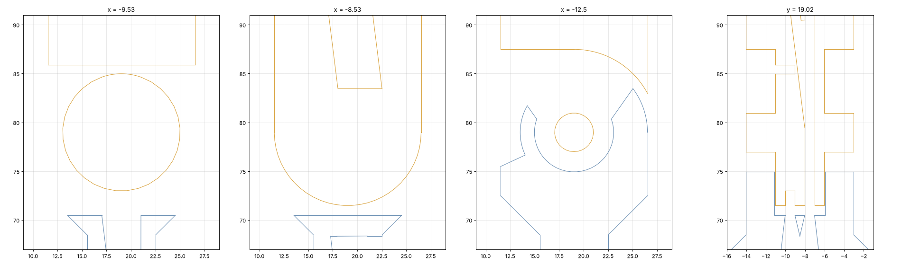
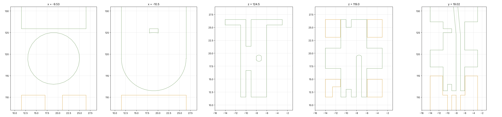

# 06 · Bearings in every hinge and the owner's one-track tendon (fingers)

Finger designer, 2026-11-13. Owner's request: "2 bearings per joint, on each side, 4x8x3 … one track per
joint like mine: one tendon, a hole at the top of the track ring, I knot it there and the motor can drag
both ways … make it possible to remove and add them for me to see."

Code: `cad/finger.py` (all four fingers). Outputs: `out/finger/<finger>/` (STEP + STL per part + JSON),
renders `out/finger/*_bearing_section.png`, `*_exploded.png`, `*_with_bearings.png` / `*_no_bearings.png`,
`*_{mcp,pip}_cut.png`, `*_{mcp,pip}_knot_cut.png`, numbers in `out/finger/summary.json`, log `out/finger/run.log`.

## 1. Owner's design (V0 index, read from the STEP)

Source: `hardware/cad/Hand assebly.step` **as of commit 8a004b5** (9 solids: the V0 thumb + index + palm).
The file at HEAD (7215915) holds only 2 bodies (the index base and proximal phalanx), so I used the older
full export. Index finger: **11.0 mm wide** (x −14.03…−3.03), 15.0 mm tall; axes along x at y 19.02;
MCP z 78.98, PIP z 118.98, DIP z 141.98 (proximal 40, middle 23 mm, as in the URDF).

*(blue = base, orange = proximal, green = middle; sections at the groove plane x −9.53, the knot window
x −10.5, across the joint, and along the axis.)*

| Feature (index, MCP and PIP are the same design) | Measured |
|---|---|
| Joint type | fork on the parent, tongue (knuckle) on the child |
| Parent side lugs | 2 × **2.9 mm** thick, round outline **R 7.5**, finger 11 mm wide |
| Bearing seat | **Ø8.1 straight through the lug** (2.9 deep, no shoulder): the 3 mm bearing sits flush (0.1 proud); radial wall around it 3.45 mm |
| Child knuckle | **5.0 mm** wide between the lugs (0.1 mm side clearance) |
| Axle | **printed Ø3.96 × 3.0 bosses** on both sides of the child, one piece with it; no steel; the inner race sits directly on the boss, the knuckle face 0.1 from the inner race |
| Track (drum) | ONE groove, **floor R 6.0, 1.0 wide** (x −10.03…−9.03, 1 mm off the finger centre), flanges R 7.5; at the MCP the groove floor is a full disc |
| Tie point | at the **top of the ring = distal side, on the finger axis (q = 0)**: a ~2 × 1.3 mm tunnel between the groove floor (r 6.0) and the shaft root (r 6.9), running sideways from the groove to a 2 mm window in the knuckle's −x face (MCP x −11.03…−9.03, y 18–20, z 84.6–85.9; PIP z 124.9–125.9). The strand runs palm side → over the top → back side; at the top it goes through the tunnel and is knotted in the side window |
| Pass-through strands | Ø1.4 (MCP) / Ø1.2 (PIP) hole along the finger axis at x −7.5, starting exactly on the joint axis, reached from the palm side through a 1 mm slot (the 2026-09-28 "pinch" fix) |
| Abduction (base) | the same recipe turned 90°: Ø3.96 bosses along y on the index base, a R 6 track 2 mm wide and two Ø0.8 tie holes |

What I take from it: (1) bearings in the parent's lugs, child between them; (2) one groove, the strand
fixed at the top of the ring so the wrap is split evenly; (3) a knot that sits in an open window you can
reach. What I change: steel axles (printed Ø4 bosses are loaded across the print layers when the phalanx is
printed on its side, and they wear the inner race fit), a shoulder so the bearing can't be pushed in too
far, a hub that clamps only the inner races, R 7 drums (brief), and the knot in a well behind the groove
wall instead of in the strand's own path.

## 2. What changed in the fingers

[filled below]
