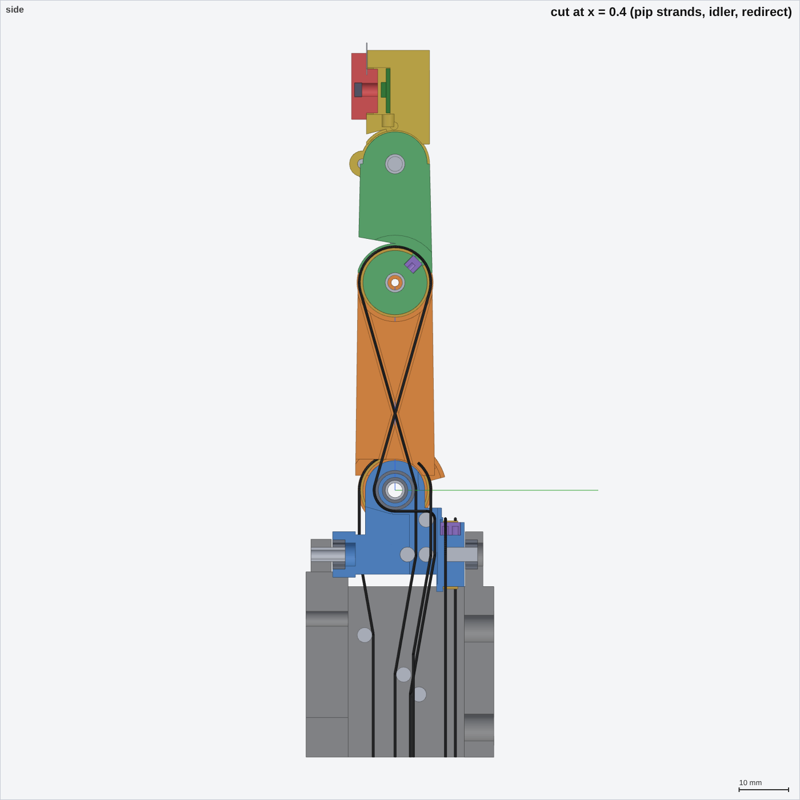
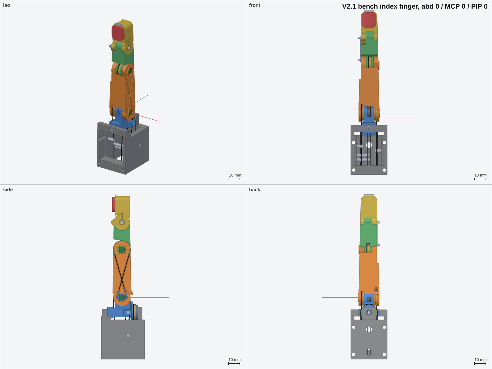

# 07 · V2.1 bench index finger (build phase)

Agent 07, 2026-11-14/15. Study only: nothing outside this folder was changed.

| File | What |
|---|---|
| `cad/07_budget.py` → `out/07/budget.txt`, `budget.json` | Settles the SYNTHESIS conflicts: travel budget, friction, tip force, stresses, DIP linkage |
| `cad/07_finger.py` → `out/07/` | The CadQuery bench finger. Run: `uv run --no-project --with cadquery --with numpy --with trimesh --with scipy --with rtree python cad/07_finger.py` (about 90 s; `--quick` = 3 poses, no renders) |
| `out/07/<part>.stl` + `.step` | One file per printed part: `base`, `yoke`, `proximal`, `middle`, `distal`, `cup_abd`, `cup_pip`, `cup_mcp_flex`, `cup_mcp_ext`, `tip_skin` (cast, not printed) |
| `out/07/assembly/bench_finger_q0.step` / `.glb` | The full assembly at q = 0: 58 named parts, bought parts included (GLB in mm, Z up) |
| `out/07/checks.json`, `strands.json`, `bom.csv` | Checks, strand polylines at q = 0, parts list with costs |
| `out/07/bench_finger_{q0,pinch,fist_abd,cut}.png` | Renders |

Frame: finger-local. The MCP flexion axis is X through the origin and the finger points along +Z.
−Y is the palm side and +X the thumb side. The abd axis runs along Y through z = −13. PIP is at z = 42,
DIP at z = 66 and the tip at z = 89 (index 42 / 24 / 23 mm, as in V2). Positive = closing.

Terms used below:
- **Loop:** the flex strand and ext strand of one joint, which together form one closed loop.
- **Coupling:** a joint turning when another joint moves. Here every coupling is linear and known, so the
  firmware cancels it.
- **s0:** a bearing's static safety factor (its static rating C0 divided by the load).

---

## 1. Design decision (the SYNTHESIS conflicts, settled)

**Chosen design ("A"): plain drums everywhere, no reeving.**
- **MCP:** a reverse fork with a fixed Ø4 tube axle. One MR84ZZ idler on that axle carries both pip strands.
- **PIP:** a plain R 7.235 drum with a brass ring.
- **Spools:** SCS0009: MCP r 4.0, PIP and abd r 5.0. HLS3606M: r 5.0 on every joint.

Four findings decided it.

1. **Reeving is the wrong tool for a travel-limited servo.**
   - A 2:1 reeved PIP doubles the strand travel. The torque only rises by 1 + η_turn = 1.69
     (Ø3 dowel turn, μ 0.12).
   - So per degree of servo travel it is **16 % worse** than a plain drum on a smaller spool.
   - With SCS0009 the limit is the 285° of usable travel, not the strand load. With HLS3606M (multi-turn)
     the limit is the MCP at the 120 N strand class. Reeving the PIP then adds only **+8 %** of pinch
     (17.6 → 19.0 N).
   - Its costs: a second groove, a 180° turn over a Ø3 pin (D/d 6.4, the fraying risk) and +4 mm of width.
     **Dropped.**

2. **SYNTHESIS item 6 as written does not work for the palm-side strand.** A strand on the palm side of a
   coaxial idler bow-strings off it after about 12° of MCP flexion. Flexion swings its far end away from the
   idler, so nothing holds it. The fix (built):
   - **pip FLEX passes on the idler's dorsal side.** Its wrap grows from 16° to 106° as the MCP closes. It
     needs no redirect, so it has no sliding bend at all.
   - **pip EXT passes on the palm side**, pre-wrapped 106° by a Ø3 redirect dowel in the yoke. It can never
     unwrap (16° left at MCP 90). The 90° slide on the redirect costs 17 %, but only on the extensor, which
     carries ~10–20 N.
   - The two strands cross inside the proximal phalanx, as in a crossed belt.
   - Both strands always need the same surface speed, so **one MR84ZZ idler** carries both, in two lanes at
     x = ±1.0.
   - MR63 would need a stepped Ø4/Ø3 axle (lathe work). MR84 fits the Ø4 axle as bought. Its larger radius
     raises the coupling from 0.45 to 0.585 PIP-degree per MCP-degree, which still fits the travel budget.

3. **The abduction crossing needs guides on the abd plane.**
   - Every flex and ext strand passes a Ø3 dowel on the yoke, placed exactly on the plane of the abd axis
     (z = −13). Each dowel bends its strand by a fixed 10° in y.
   - Below that dowel the strand swings like a pendulum, but its pivot sits on the axis plane. Abduction
     therefore changes the loop length only to second order: **0.02 mm (pip), 0.03 mm (MCP), 0 (abd)**.
   - My first layout fixed the guides 11 mm above the axis. The loops then went 0.3–0.6 mm slack at ±15°.
     That is common-mode, which a servo cannot correct.
   - The leftover differential coupling is linear: **MCP 0.86° per abd-degree, PIP 0.135° per abd-degree**.
     The firmware cancels it.

4. **The SCS0009 travel just fits.** The table below is for the hand: wrist compensation 3.6 mm (01's eye
   plate), the abd coupling, and 15° kept free for calibration.

### Budget table (`out/07/budget.txt`)

| Joint | Strand travel needed (mm) | Of which coupling | SCS0009 spool r | SCS servo deg used / 285 | HLS spool r | Strand at stall SCS / HLS | Firmware coupling term |
|---|---|---|---|---|---|---|---|
| mcp_abd | 7.4 (3.8 bench) | wrist 3.6 | 5.0 | 85 | 5.0 | 45 / 118 N | – |
| mcp_flex | 19.5 (15.9 bench) | abd 3.3 + wrist 3.6 | **4.0** | **280** | 5.0 | 57 / 118 N | + 0.86 × q_abd |
| pip | 24.1 (20.5 bench) | idler 7.4 + abd 0.5 + wrist 3.6 | 5.0 | **277** | 5.0 | 45 / 118 N | + 0.585 × q_mcp + 0.135 × q_abd |
| PIP reeved (rejected) | 36.8 | | needs r ≥ 7.4 | | | | |

How to read the spools:
- The SCS0009 MCP spool at r 4.0 leaves only 5° of margin. If calibration needs more, use r 4.2; the straight
  push drops 5 % and the pinch not at all.
- The pinch is limited by the PIP, not the MCP, so the r 4.0 MCP spool helps only the straight push.
  On the bench, without the wrist, there is 40° of spare travel.

### Friction and fingertip force (index, pinch MCP 30 / PIP 45; straight = pushing with a straight finger)

| Route | Sliding turn | η |
|---|---|---|
| MCP flex, bench / hand (+ forearm comb, palm guide) | 20° / 45° | 0.96 / 0.91 |
| pip flex, bench / hand (+ 1 idler, rolling) | 20° / 45° | 0.95 / 0.91 |
| pip ext (redirect 90°) | 110° | 0.79 |
| V2 for comparison (01) | 223–246° in PTFE | 0.65–0.68 |

| Servo, torque | Pinch, bench | Pinch, hand | Straight push, bench | Limiting joint |
|---|---|---|---|---|
| SCS0009 stall (0.226 N·m) | **6.8 N** | 6.4 N | 4.8 N | PIP |
| SCS0009 80 % (usable peak) | 5.4 N | 5.1 N | 3.9 N | PIP |
| SCS0009 continuous (0.074) | 2.2 N | 2.1 N | 1.6 N | PIP |
| HLS3606M stall (0.59) | **17.6 N** | 16.7 N | 10.1 N | PIP |
| HLS3606M 80 % | 14.1 N | 13.4 N | 8.1 N | PIP |
| HLS3606M continuous (0.15) | 4.5 N | 4.3 N | 2.6 N | PIP |

V2 as built: 4.5 N pinch at stall (01). The gain comes almost entirely from friction (η 0.65 → 0.95) and
from the r 4 MCP spool.

### Stresses at the design class (strand T = 120 N = HLS stall on r 5; SCS in brackets)

| Item | Number | Verdict |
|---|---|---|
| Line on the brass ring, T/(R·d) | 35 MPa [17], D/d 31 | brass OK |
| PETG under the 0.5 mm ring | 11.3 MPa [5.3] | at the ~12 MPa creep limit at HLS **stall**, 2.9 MPa continuous: OK |
| Line on Ø3 dowels | 170 MPa, D/d 6.4, 10° bends (90° only on the low-load ext redirect) | hardened steel OK; fatigue: bench test |
| MCP axle Ø4 × 0.5 stainless tube, bearing lever 2.95 mm | 129 MPa (drive at HLS stall), 82 MPa (20 N sideways tip) | OK for hard-drawn 304; use a solid hardened dowel (89 / 56 MPa) if the wire is routed another way |
| Tongue cheek through the Ø5 brass sleeve (2.5 mm cheek) | 15 MPa at HLS stall, 9.6 MPa at 20 N sideways, 3.8 MPa HLS continuous | **marginal at HLS stall:** PA-CF yoke for HLS runs |
| MR84ZZ in the MCP lugs (C0 139 N, NSK) | s0 1.68 SCS stall, **0.74 HLS stall**, 2.9 HLS continuous | HLS stall can brinell. Cap HLS torque at 80 % in firmware (HLS reads its current) |
| MR84ZZ idler | s0 1.49 at the pinch, **0.73** at fist + HLS stall [1.94 SCS] | same as above |
| DIP bar (0.8 × 3.2 stainless, Ø2.05 holes) at 30 N tip | 68 N bar, 74 MPa net (SF 2.9) | OK |
| Ø2 bar pins set 4 mm deep | 16.3 MPa edge at 30 N tip (5.4 MPa at 10 N) | OK up to ~20 N tip; PA-CF or a brass bush above that |
| PIP −x brass bush / DIP bushes | 4.4 / 3.3 MPa on PETG | OK |
| Fuse cup lip (shear plug of a 1.8 mm bead) | 68 N printed flat t 0.8 (SCS), 170 N on its side t 1.2 (HLS) | the line (445 N) never sees more than the trip load |

### DIP bar with pin A off the thin web

- With the 2nd MR84 on the bar side of the PIP, pin A has to sit at r ≥ 6.6 to keep a 1.6 mm wall.
  Then no linkage inside the finger reaches 0.75: the best I found had a 3.5° error.
- So the **bar side (−x) of the PIP runs on a Ø5 brass bush** and the +x side keeps the MR84. The bush sees
  4.4 MPa.
- Result:
  - Pin A at r 5.10, 28.8°, with a **1.60 mm web**. Pin B at r 6.60, −89.8°, with a 3.1 mm web.
  - Bar 21.55 mm.
  - **Max |DIP − 0.75 PIP| = 0.43°** (V2: 0.51° with pin A in a 0.28 mm web). Transmission angle ≥ 36°.

---

## 2. Parts list

| Part | What it is | Key features |
|---|---|---|
| `base` | Bench block, 32 × 38 × 41 mm | Rear block behind the "palm plane"; open front bay where the curled finger goes; low palmar bridge holding the fixed Ø3 abd stub (top z −9.9, under the proximal at MCP 90); dorsal lug with an MR63 seat; strand channel open to the front for threading; 4 cantilevered Ø3 guide dowels that turn each strand back to vertical; 6 strands leave the bottom straight down; 2 × M5 holes on 20 mm (2020 slot) + 4 × M3 holes (plate) in the dorsal face |
| `yoke` | abd child / MCP parent | Tongue (|x| ≤ 4.2) holding the Ø4 axle in 2 brass sleeves (5 × 0.5 × 2.9; they also space the races); 3.4 mm idler slot; redirect dowel; 2 abd-plane pip dowels; 2 MCP "ears" with abd-plane dowels and flared strand slots; MR63 seat (palmar) and Ø3 stub (dorsal); abd disc with a 3 mm brass ring and a 2-lane fuse cup at the top; Ø1.6 wire path axle → palmar stub |
| `proximal` | Reverse-fork MCP child, PIP fork parent | 2 lugs (4.6 mm) with MR84 seats; MCP drums = 14 × 0.5 brass rings (1.6 wide) on the lug cores, lanes x ±6.4; tangential single-lane fuse cups (flex in a knuckle hood, ext into the shaft root); swept clearance for the yoke and for the MCP strands; crossed pip strand grooves **open toward +x** (lay-in); PIP lugs: −x Ø5 brass bush + pin A, +x MR84 seat; Hall pockets 4.6 × 4.6 × 1.0 on the +x MCP and PIP lugs (+0.6 / +1.0 mm bosses); wire groove along the −x face; −x face recessed to −6.85 for the bar (z > 30) |
| `middle` | PIP child, DIP parent | Hub with a 3 mm brass ring (lanes −0.2 / +1.8), radial 2-lane fuse cup at 45°; ring slot open to r 9.6 so the ring slides on axially; Ø4 tube PIP pin pressed; DIP tongue with the Ø4 tube DIP pin; Ø1.6 teardrop wire channel pin → pin |
| `distal` | DIP fork + sensor tip | Cheeks with Ø5 brass bushes; pin-B lobe; 05's sensor-ready tip merged in and scaled to the 14 mm taper (cavity opening ±3.8, widest ±5.2, 4.8 deep, side wall ≥ 1.8; 9.2 × 9.0 PCB; Ø2.6 cable bore; nail-shim slot); wire groove on the +x cheek |
| `cup_*` (4) | Fuse cups | 2-lane oval (abd, PIP: Ø1.5 chambers at ±1.0) and 1-lane round (MCP); lip t 0.8 (SCS) or 1.2 printed on its side (HLS) |
| `tip_skin` | Snap-in silicone skin | 05's design scaled; magnet hole; cast in 05's mould (scale the mould script the same way) |
| `dip_bar` | Bought/laser-cut | 0.8 × 3.2 stainless, holes 21.55 apart |

Printed mass (100 % infill): base 22.8 g, proximal 11.3, middle 4.9, distal 4.4, yoke 4.0, cups 0.02 each.
The finger alone is about 25 g.

---

## 3. Checks (`out/07/checks.json`)

| Check | Result |
|---|---|
| Every part a valid single closed solid; printed STLs watertight | **57/57 valid and single-solid (+ the DIP bar); all 10 exported STLs watertight** |
| Interference, OCC boolean > 0.05 mm³ between bodies: abd {−15, 0, 15} × MCP {0, 45, 90} × PIP {0, 50, 100}, plus fists at PIP 95 | **27/30 clear.** The 3 hits are all `tip_skin` vs the base bridge at **MCP 90 + PIP 100**: 0.36 mm³ (abd 0) and 7.9 mm³ (abd ±15). That is the fingertip pad pressing ~0.4 mm into the "palm" in a full fist, 5° past the PIP servo limit. At PIP 95 all three fists are clear. |
| Strand centrelines inside any solid (0.4 mm steps; poses q0, (15, 45, 50), (−15, 90, 95)) | **0 points** for all 6 strands |
| Loop-length variation over the grid abd ±15 × MCP −10…90 × PIP −5…95 (5 × 11 × 11 poses) | **pip 0.021 mm, MCP 0.029 mm, abd 0.000 mm** (≈ 1 N of pretension change). 01's target was 0.036 mm. |
| Own slope | 0.1263 mm/° on every joint (R 7.235) |
| Couplings (firmware adds them) | **pip 0.585 per MCP-degree, pip 0.135 per abd-degree, MCP 0.862 per abd-degree**; deviation from a linear model ≤ 0.006 mm (pip) / 0.010 mm (MCP) |
| Minimum wrap on every guide over the grid | pip flex: drum 56°, idler 6°, dowels 10° / 10°. pip ext: drum 56°, idler 16°, redirect 90°, dowels 10° / 10°. MCP: drum 40°, dowels 10° / 10°. **Every strand stays on every guide.** |
| DIP | max error vs 0.75 × PIP **0.43°**; DIP 71.4° at PIP 95 |

Method notes:
- The strand lengths are exact belt paths (common tangents and arcs) in each strand's plane. Abduction is
  applied in 3D to the free segment between the abd-plane dowel and the base dowel.
- Small fleet angles are ignored: 1.2° (idler to PIP ring) and up to 4° (pendulum below the abd plane).

**Walls ≥ 1.6 mm, with these exceptions** (all non-structural, or with metal behind them):
- Ring flange lips 0.5 mm (r 7.0 → 7.5). They only guide the strand; the anchor and the entry guide fix its x.
- PIP −x lug: 0.2 mm skin between the 1.0 mm wire groove and the brass bush end. MCP −x lug: 0.6 mm between
  the wire groove and the bearing lip ring.
- Fuse-cup pocket side skins: 1.1 mm (PIP), 0.65 mm (abd). The cups are pulled radially, so these skins carry
  no load.
- Hall PCB pocket floors: 1.2 mm (MCP lip ring).
- Outer prong of the MCP ears: 1.34 mm at the bottom edge, where the slot flares.

**Not modelled:**
- Teardrops on the yoke's Y-axis holes (the MR63 seat and the dorsal stub, when the yoke is printed on its
  side) and on the base's X-axis dowel holes. Add them in the slicer, or ream.
- Hard stops and TPU bumpers.
- Fillets.

---

## 4. What the owner prints and buys

**Print** (PETG, 0.16 mm layers, 4 walls, 25 % gyroid; print the 04 coupon first and use its hole and seat
offsets):

| Part | Orientation | Note |
|---|---|---|
| `proximal`, `middle`, `distal` | on the −x face (x up) | Seats, pin holes and dowel holes are vertical, so they print round. The strand grooves are open upward. The wire channels are teardrops. |
| `yoke` | on its side (x up) | Ream the MR63 seat (Y axis) after printing |
| `base` | dorsal face down | MR63 seat and M5 holes vertical; dowel holes horizontal (teardrop in the slicer) |
| cups | SCS: flat (68 N trip); HLS: on the side (170 N) | Print 10 spares of each |
| `tip_skin` | not printed | Cast Dragon Skin 20 in 05's mould |

For HLS runs, print the yoke, proximal and middle in PA-CF.

**Buy** (`out/07/bom.csv`, about **€55** for one bench finger without servos; most items come in packs that
also cover the full hand):
- 4 × MR84ZZ, 2 × MR63ZZ.
- Tubes: stainless 4 × 0.5, brass 5 × 0.5, brass 14 × 0.5, stainless 3 × 0.5.
- Dowels: Ø3 × 8 (×3), Ø3 cut to length (×2 ears + 1 stub + 4 base guides), Ø2 × 6 (×2) + 2 push-on
  washers.
- 0.8 mm stainless strip (DIP bar).
- PE#8 braid (pre-stretch it 24 h at 30 % of its break load).
- 1.3 mm aluminium crimp sleeves.
- 2 diametric Ø3 × 2 magnets + 2 TMAG5273 (or AS5600) on 4.6 mm boards; MLX90393 + Ø3 × 1.5 magnet (tip).
- 36 AWG silicone wire, retaining compound (641 = removable), M5 + T-nuts / M3.

---

## 5. Assembly and strand replacement

**Assembly** (finger-out, about 1 h):
1. **Rings.** Slide the brass rings on axially, with a dot of 641 retaining compound:
   - MCP rings from the inner side of each lug, with the gap at the cup.
   - PIP ring from the −x side of the hub.
   - abd ring from the +y side of the disc.
2. **Pressed parts.** Press in the MR84 outer races (proximal lugs, PIP +x), the brass bushes (PIP −x, DIP
   ×2), the sleeves (tongue) and the MR63 (yoke palmar). Use line-to-line seats plus 641.
3. **Distal.** Push the DIP pin (Ø4 tube, wire slot facing +y) into the middle tongue through the distal
   cheeks.
4. **PIP.** Put the middle between the proximal's PIP lugs. Push the PIP pin through the bush, the hub and
   the MR84. Drop the PIP magnet into the +x pin end.
5. **MCP.**
   - Fit the idler (MR84) into the tongue slot.
   - Slide the proximal over the tongue.
   - Push the axle in from +x through the bearing, sleeve, idler, sleeve and bearing, with the wire slot at
     x −3 facing −z. Lock it with 641.
   - Drop the MCP magnet into the +x axle end.
   - Press the 5 yoke dowels: redirect, 2 abd-plane, 2 ears.
6. **Bar.** Press pins A and B, put the bar on, and fit the push-on washers.
7. **Base.**
   - Put the yoke between the base lugs.
   - Push the dorsal stub through the dorsal MR63 into the yoke.
   - Push the palmar hollow stub through the bridge into the yoke's MR63.
   - Press the 4 base dowels in from the side walls.
8. **Sensors.** Pull the 4-wire bundle tip → DIP pin → middle channel → PIP pin → −x face groove → axle →
   yoke → palmar stub, with a 0.25 mm wire leader. Pot the Hall PCBs into their pockets.

**Replacing one strand** (example: pip flex; about 5 min; nothing comes apart):
1. Slack the loop at the servo end (tensioner, 02's cartridge) or lift the hanging weight.
2. Pull the old pip cup out of its pocket on the middle hub and cut the strand.
3. From the bottom of the base, feed the new doubled-end strand up:
   - between its base dowel and the wall;
   - up the yoke slot on the dorsal side of its abd-plane dowel;
   - over the dorsal side of the idler;
   - into the proximal's open +x groove (lay it in from the side);
   - onto the PIP ring, around the palm side to the top.
4. Crimp a sleeve on the doubled end. Drop it into the cup chamber and push the cup into its pocket.
5. Tension it at the spool (02's chordal screw, 1/8 turn ≈ 0.9 N) and check the pluck pitch.

The ext strand follows the same path but also passes over the redirect dowel and under the idler; use the
leader. The MCP strands are reached from the inner side of each lug, between the tongue and the ring (there
is no inner flange). The abd strands go straight from the disc to the base.

---

## 6. Open risks (what fails first, and the bench test)

1. **MR84 static load at HLS stall** (s0 0.73–0.74 at the lug bearings and the idler).
   - Mitigation: an 80 % torque cap (HLS current sensing).
   - Test: 1000 stall events at 118 N strand, then check the bearings for roughness.
   - If they fail: 684ZZ (4 × 9 × 4), which needs +1 mm of lug width.
2. **Tongue cheek creep at HLS stall** (15 MPa on PETG). Print the yoke in PA-CF for HLS runs. Measure
   axle-to-tongue play after 24 h at 118 N.
3. **The PE#8 strand on Ø3 dowels** (D/d 6.4).
   - Only 10° bends, plus 90° on the low-load ext redirect.
   - Run 02's B2 wear test on the redirect at 20 N.
4. **Pendulum strands below the abd plane** (up to 4° of x-lean): the strands may walk on the abd-plane
   dowels and the idler lanes are only 2 mm apart. Test: sweep abd ±15° 10 000 times under pretension and
   look for lane crossing.
5. **The SCS0009 300° range is from memory.** The MCP spool r 4.0 leaves only 5° of margin. Measure the real
   range first. If it is short, use r 4.2 (−5 % straight push, no effect on the pinch).
6. **Firmware couplings** (pip += 0.585 q_mcp + 0.135 q_abd; MCP += 0.862 q_abd, in joint degrees).
   - They are linear and come from CAD.
   - Verify with the Hall sensors on the bench by sweeping one joint while holding the servos.
7. **Wire twist in the hollow pins.** The free on-axis length is only ~7 mm at the PIP, so strain is ~0.5 %.
   Run 05's bench test 4 (100 k cycles).
8. **Fist contact.** At MCP 90 + PIP 100 the skin presses ~0.4 mm into the base bridge. That is intended palm
   contact, but in software keep PIP ≤ 95 at MCP 90 on the bench.
9. **Not built in this CAD:** hard stops and TPU bumpers, fillets, the slicer teardrops on the yoke and base,
   and the spool-side cartridges (02). Strands end at z = −54 under the base: hang weights or route them to
   02's cartridges.

## 7. Sources

This study:
- `SYNTHESIS.md`.
- Reports 01 (levers, eye plate, wrist span), 02 (PE#8, dowels, MR63 / MR84 C0 from NSK and Misumi, spool
  cartridge, tensioner), 03 (reverse fork, ring + fuse cup, bar pins, bushes), 04 (orientation, walls, PA-CF,
  coupon) and 05 (tip, skin, Hall, hollow pins).

V2 study (`cloud-claude/2026-11-09-v2-hand-cad`):
- `cad/finger.py`, `params.py`, `reports/01-finger.md`, `06-bearings-track.md`.
- `cad/tools/render.py` and `export.py`.

Repo:
- `hardware/cad/dip_linkage.py` (`dip_curve`, `check`; re-searched with Ø2 pins and walls of 1.6 mm or more).

From memory, verify before buying:
- SCS0009 300° range; HLS3606M 0.59 N·m and multi-turn mode.
- MR84ZZ C0 139 N.
- The 304 tube yield; PETG creep ~12 MPa; the PE#8 diameter and break load.
