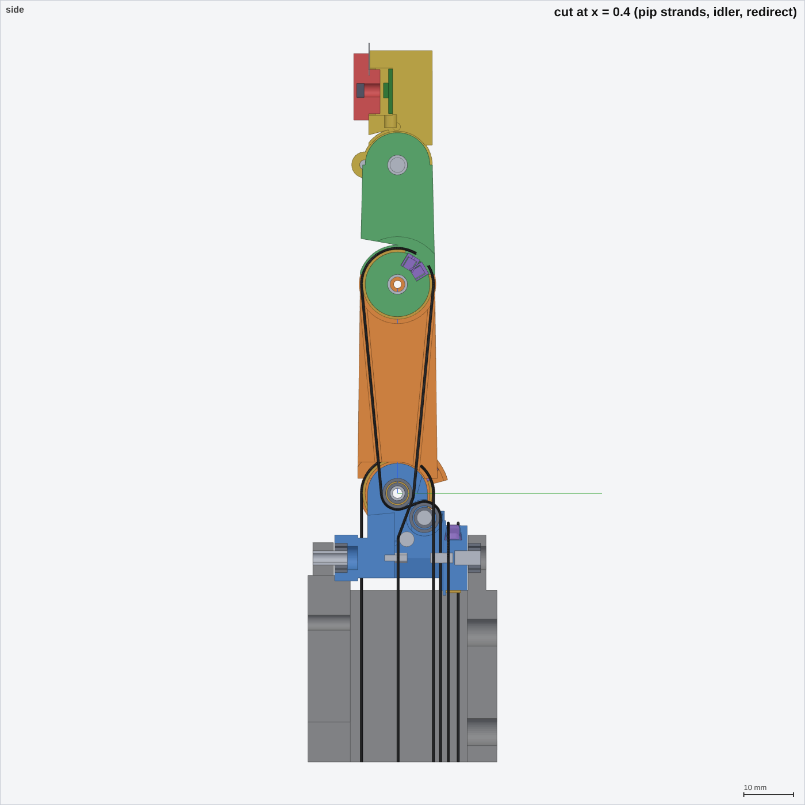

# 12 · Bench finger, round 2: the review's fixes (phase 1)

Agent 07, 2026-11-15. Study only. The 07 files are kept unchanged.

| File | What |
|---|---|
| `cad/12_budget.py` → `out/12/budget.txt`, `budget.json`, **`travel_table.json`** | Full moment budget, friction, travel, fuse cup, axle stress, rolling-element loads, plus the **shared travel and coupling table** |
| `cad/12_finger.py` (copy of 07, changes marked `# R2`) → `out/12/` | CadQuery finger. Run: `uv run --no-project --with cadquery --with numpy --with trimesh --with scipy --with rtree python cad/12_finger.py` (~2.5 min). Writes STL + STEP per printed part, `assembly/bench_finger_q0.step` and `.glb`, `checks.json` (including the pitch analysis), `strands.json`, `bom.csv` and 4 renders |
| `out/12/pitch_no_sensor_bosses.json` | Pitch analysis with the Hall bosses removed (#4) |

The fixes refer to the numbered findings in `reports/10-review.md`. Terms:
- **Open belt:** a strand that stays on the same side of two pulleys, so it does not cross over.
- **x-nip:** two steel pins along Y, one on each side of a strand, that fix where the strand bends sideways.

## 1. Review #1: the pip flex strand now helps the MCP

**What changed:**
- **Flex strand (pip flex):**
  - It runs on the **palm side** of the MCP idler. The idler is now an MR63ZZ on a Ø3 inner axle tube.
  - From the idler it goes to the PIP drum's palm side as an open belt, so nothing crosses inside the
    proximal any more.
  - Pre-wrap comes from an **MR63ZZ roller** placed dorsal and below the idler, at (y 5.41, z −4.92). The
    strand leaves the idler bottom rising 20°, goes over the roller, then straight down its back.
  - Idler wrap is 104° at MCP −10 and **14.5° at MCP 90**, so the strand never comes off the idler.
- **Extensor strand (pip ext):**
  - It runs on the **dorsal** side of the idler (open belt).
  - On its own it would lose contact with the idler below MCP +5.5° (pip loop variation 0.36 mm, found in this
    round). A Ø3 dowel below the idler, cantilevered from the +x cheek, pre-wraps it 15° (5° left at MCP −10).
  - The dowel bend is 20.5° of sliding, but only on the extensor, which carries 10–20 N.

**Force budget with every moment arm** (`budget.txt` §3).
- The PIP drive needs η·T_p·R − T0·R ≥ F·L_pd.
- The MCP needs η·(T_m·R + s·T_p·ρ) − T0·R − s·T0·ρ ≥ F·L_mcp, with s = +1 (palm side), ρ = 3.235 mm.
- T0 = 5 N is the pretension; L_pd and L_mcp are the levers from 01: pinch 46.2 / 43.1 mm, straight push
  50.2 / 81.0 mm.
- Joint friction is included (#12): PIP bush plus DIP bushes and bar pins give η_joint 0.949 when greased
  (μ 0.15), and 0.899 when dry (μ 0.3).

| Index tip force | Pinch (MCP 30 / PIP 45) | Limited by | MCP margin | Straight push | Target (review) |
|---|---|---|---|---|---|
| SCS0009 stall, bench | **5.9 N** | PIP | ×1.6 | 5.1 N | ~6.7 N |
| SCS0009 80 % (usable), bench | 4.6 N | PIP | ×1.6 | 3.9 N | |
| SCS0009 continuous | 1.4 N | PIP | | 1.2 N | |
| HLS3606M stall, bench | **16.6 N** | PIP | ×1.6 | 14.2 N | ~17.6 N |
| HLS3606M 80 % | 13.1 N | PIP | | 11.2 N | |
| SCS0009 / HLS stall, hand (+25° sliding at the forearm and palm guides) | 5.6 / 15.7 N | PIP | | 4.8 / 13.5 N | |
| 07 as built (same method; reproduces the review) | 5.6 / 11.7 N | MCP | | 3.6 / 7.4 N | |

- **Why I get 5.9 N and not 6.7 N:** the review's 6.7 N leaves out the 5 N extensor pretension (−0.8 N) and
  the bush friction (−5 %).
- The MCP is no longer the limit in a pinch (1.6× margin). In a straight push it is exactly at its limit
  (×1.00), now on the r 5 spool.
- HLS straight push rises 7.4 → 14.2 N.
- **For HLS runs the MR63s are too small.** The roller sees s0 0.48 and the idler 0.59 at HLS 80 %. Use
  F683ZZ / MR83 (3 × 8 × 3; check its C0), or a hardened Ø3 dowel redirect (η 0.79, about −20 % pinch). With
  SCS0009 every rolling element has s0 ≥ 1.25.

## 2. Review #2: every spool r 5, and one shared travel table

**`out/12/travel_table.json` is written.** It is the one table for the CAD, for agent 09 and for the firmware:
- G = 1.447 (drum line radius 7.235 / spool 5.0).
- Per servo: own range, signed coupling coefficients measured from the CAD strand model, servo degrees without
  the wrist, the wrist budget left on SCS0009, and the lane position of each strand on the abd plane.
- SCS0009 range: 300° from the datasheet as I remember it, with `travel_deg_measured` left as a placeholder
  to fill on day 1. Calibration margin 15°.

| Joint (servo IDs, all four fingers) | Firmware command (joint-equivalent degrees) | Servo deg without wrist | Wrist budget left on SCS0009 |
|---|---|---|---|
| pip (1, 8, 11, 14) | q_pip **+0.447** q_mcp **−0.123** q_abd | **214.7** | 70.3° = 6.13 mm of strand |
| mcp_flex (2, 9, 12, 15) | q_mcp **−0.821** q_abd | 180.4 | 104.6° = 9.13 mm |
| mcp_abd (3, 10, 13, 16) | q_abd | 43.4 | 241.6° = 21.1 mm |

- **Sign convention:** positive = more strand wound in. The abduction signs belong to this lane layout: the
  flex strands sit at −x.
- **Thumb:** placeholder only (own ranges on r 5). I did not design it.
- **Compared with 07:** pip 235 → 215 servo-degrees, because the MR63 idler gives 0.447 coupling instead of
  0.585. The MCP moves r 4 → r 5. Both now leave room for 09's eye law (≈ 9.7|x| + 17.4|y| servo-degrees on
  r 5).
- The review found that this combination fits all 8 pip/MCP eye pairs; 09 must confirm it in its re-run.
- **Lanes at the abd plane** (in the table): pip flex (−0.9, y 8.64), pip ext (+0.9, y 0.12),
  MCP (±6.0, ∓7.235).

## 3. Review #5: fuse cup sized to a real crimp

- **The bead is a 2 × 2 mm crimp tube** (copper or brass, jewellery size: ID ≈ 1.4, OD 2.0, length 2.0). The
  doubled PE#8 (0.94 mm) fits inside. Crushed flat with pliers it measures about **2.6 × 1.1 mm**; measure
  your own.
- **Cup:** chamber 2.9 × 2.1 × 2.3 deep, outside 3.5 × 2.7, height 2.9.
- **One cup per strand.** The PIP and abd cups sit at the anchor angle ±14°; the MCP cups are tangential. The
  two-lane oval cup did not fit a real crimp.
- **Trip load** is the lip shear around the bead outline: perimeter 7.4 mm × lip t × τ.

| Load class | 80 % strand cap | Lip | Trip | Ratio to the 80 % cap (at −25 % print scatter) |
|---|---|---|---|---|
| SCS0009, r 5 | 36.2 N | 0.6 mm, printed flat (τ 15 MPa) | **67 N** | 1.84 (1.38) |
| HLS3606M, r 5 | 94.4 N | 0.8 mm, printed on its side (τ 25 MPa) | **148 N** | 1.57 (1.18) |

- The crimp on doubled braid holds ≥ 312 N, more than 2× the HLS trip, so the cup always fails first.
- With the cup trip set, a push against a holding fingertip trips the PIP fuse at **11.7 N** (SCS) or **26 N**
  (HLS).
- Whether the fuse protects the servo gears depends on the SCS0009 gear-strip torque (review #11f). Measure it.
- **Not modelled:** a retention rib for slack cups (#17). Use a dot of CA glue for now.

## 4. Review #6, #7, #8, #12, #13, #16

| # | Fix | Number |
|---|---|---|
| 6 | **Nested MCP axle.** An inner Ø3 × 0.5 stainless tube carries the wires and the MR63 idler. Two Ø4 × 0.5 sleeves run under the MR84s and through the brass cheek sleeves, and also space the races. The wire slot is at x −3, facing **+y**, which is on the neutral axis: all the large loads are along z (strand pulls, and the couple from a sideways tip force). | Section modulus 4.30 (07) / 2.62 (07 slotted) → **5.70 mm³**. HLS-stall drive **98 MPa** (07 slotted: 212 nominal, ~420 with stress concentration); 20 N sideways tip **62 MPa** |
| 7 | **Hall magnets moved off the bearing races.** The magnet (Ø3 × 1.5, diametric) sits on a printed PETG carrier in the axle or pin end, **2.0 mm beyond the steel race face**. Then: 0.3 mm floor, 0.5 mm air gap, TMAG5273 (2.9 × 2.8 SOT-23-6) on a 4.6 mm board in a cap on the +x lug. The MCP and PIP magnets are 42 mm apart (the scout's 3° crosstalk was at 10 mm). | **Cost:** the +x side of the MCP and PIP grows by about **+4 mm** (lug face 9.0 → 13.2). Phase 2 (report 15) may choose a slimmer layout. |
| 8 | **abd crossing.** The Ø3 dowels along x, the 10° slants, the printed slot necks and the 4 base dowels are gone. Every strand reaches the abd plane vertically and passes a **steel x-nip on that plane** (Ø2 pins for the pip strands, cantilevered 2 mm into the slot end walls; Ø1.5 pins through the MCP ears). No strand bends over plastic, and the ≤ 15° sideways bend happens on the axis plane. | Loop length variation over abd ±15 × MCP × PIP: **pip 0.00002, MCP 0.001, abd 0 mm** (07: 0.021 / 0.029). Line on the pins at HLS stall: 255 MPa (Ø2), 340 MPa (Ø1.5); D/d 4.3 and 3.2, only when abducted. Bench test it. |
| 12 | Bush friction is now in η | η_PIP_joint 0.949 (greased) / 0.899 (dry); costs ~5 % of pinch |
| 13 | **Retaining compound.** Loctite 641 only metal-to-metal (axle in the sleeves); epoxy in plastic seats | (BOM) |
| 16 | **Real first-buy cost** (`out/12/bom.csv`, whole packs) | **€193 without servos, €232 with 3 SCS0009.** About €20 per finger once the packs are shared across the hand (+ servos). Largest items: custom Hall/tactile boards €35, silicone kit €33, epoxy and Loctite €18, braid €15, pin assortment €12 |

## 5. Review #4: can the knuckle fit a 19.5–20 mm pitch?

**Method:** `pitch_analysis()` in `12_finger.py`. Two copies of the finger (base excluded) are placed at the
same MCP/PIP pose; finger B sits +p toward the thumb. The script takes x-extents in 1 mm (y, z) bins, adds a
0.5 mm clearance plus one neighbouring bin, and records the smallest p that gives no contact. Results are in
`checks.json` → `pitch_mm_needed` and in `out/12/pitch_no_sensor_bosses.json`.

| Case | Needed pitch |
|---|---|
| Neighbours at the **same** abduction (−15…+15), MCP 0 / 45 / 90, **without** the +x Hall bosses | **18.6–19.6 mm: fits 19.5–20 mm** |
| Same, **with** the R2 Hall bosses on the +x side | 23.1–24.6 mm: fits only for the index, whose +x side faces the thumb |
| Neighbours abducting **toward** each other by 7.5° (relative) | 21–28 mm (the 100 mm finger swings) |

What this means:
- **Relative adduction** stays limited in software, as in V2: at 20 mm pitch about 1° of relative adduction
  (interpolated). Spreading apart is unlimited.
- **The fixed parts of a palm knuckle module** (the palmar bridge boss with its Ø3 stub, and the dorsal lug
  with its MR63) are all within |x| ≤ 6. The rest of the 19.5–20 mm cell is the yoke's swing space
  (ears ≤ |x| 9.4). Neighbours can share the walls between them.
- This **replaces 07's bench base and 09's idler block** in the hand. The strands leave each module straight
  down at the lane positions in the travel table.
- **The Hall placement is the constraint left for phase 2:** the middle and ring fingers cannot carry +4 mm
  bosses on either side.

## 6. Checks (`out/12/checks.json`)

- **Parts:** 66/66 valid single solids. All 13 exported STLs are watertight (base, yoke, proximal, middle,
  distal, 6 cups, tip skin).
- **Interference** over abd {−15, 0, 15} × MCP {0, 45, 90} × PIP {0, 50, 100}, plus fists at PIP 95:
  **27/30 clear.** The only contact is the skin on the base bridge at MCP 90 + PIP 100, as in 07 (the palm
  contact of a full fist, 5° past the servo limit). The PIP 95 fists are clear.
- **Strand centrelines inside solids:** 0 points, at three poses.
- **Minimum wraps over the grid:**

  | Strand | Drum | Idler | Roller / dowel |
  |---|---|---|---|
  | pip flex | 31.5° | 14.5° | roller 110° |
  | pip ext | 31.5° | 5.0° | dowel 20.5° |
  | MCP | 40° | – | – |

- **Couplings** (measured): pip +0.447 per MCP-degree, −0.123 per abd-degree; MCP −0.821 per abd-degree.
  Linear-fit residual ≤ 0.006 mm.
- **DIP:** 0.43° error (unchanged).
- **Printed mass:** base 23.0 g, proximal 11.7, middle 4.9, distal 4.4, yoke 3.8; cups 0.01–0.02 g each.

## 7. Wall exceptions and open items

Walls below 1.6 mm (all except the first are carried over from 07):
- MCP cup pocket to the bearing seat: 1.4 mm. The pocket is radial now, 3.5 mm deep for the crimp.
- Ring flange lips: 0.5 mm.
- Wire groove skins: 0.2 / 0.6 mm.

Assembly and printing:
- The pip nip pins are cantilevers pressed 2 mm and set in epoxy.
- The roller dowel is pressed only 1.55 mm on its −x side (where the roller pocket widens the slot), and 2.3 mm
  on +x. Use epoxy.
- Print the yoke **dorsal side down** (#14).
- Add a 2.15 mm raft pad under the proximal's bar face, or sand it flat after printing.
- Teardrops on the yoke's Y-axis holes and the base's holes are left to the slicer.

Tests:
- 08's kit should add: the x-nip fray test at 15° (Ø1.5 / Ø2 pins), a test of the crimp tube in the cup
  (pass: trip ≥ 1.5 × the capped strand, CV < 15 %), and the Hall test with the magnet 2 mm proud.
- Bench pass limits from this budget: pinch at SCS 80 % ≥ 4.6 N × 0.8 = **3.7 N** (kill below 3.0 N);
  loop pretension 5 ± 2 N after 1 week (#9 is still open: a bottoming spring at the spool is not designed here).

Waiting for others:
- **Phase 2 (sensors):** joint-angle sensors on every joint, tip and pad sensing, and wiring will follow
  `reports/15-sensing-plan.md` / `out/15/sensor_spec.json`. Space kept for them:
  - the hollow MCP inner tube (Ø2 bore), the PIP and DIP tube pins (Ø3 bore) and the yoke wire channel to the
    hollow palmar stub;
  - the +x Hall caps;
  - the distal tip cavity (9.2 × 9.0 PCB) and the cable bore.
- **For agent 09:** use `out/12/travel_table.json`. Its lane positions and signs replace 07's numbers.
