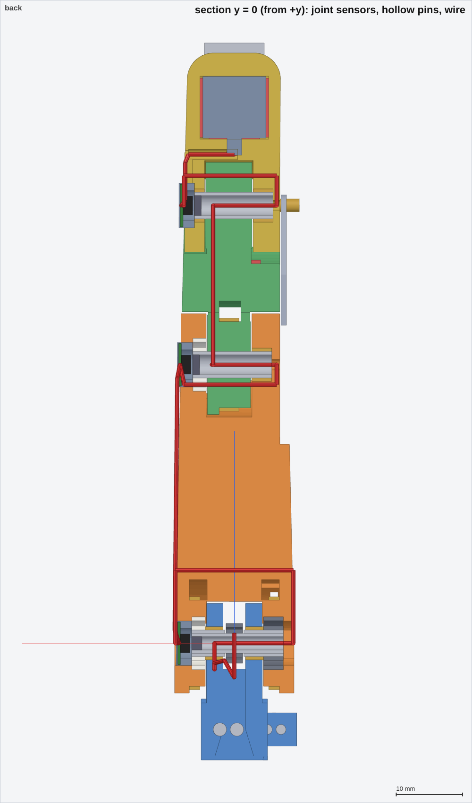

# 16 · Bench finger with sensors (R3 slim from report 15)

Agent 07, phase 2 of round 2, 2026-11-15. Study only. The phase-1 outputs (`out/12/`) and 07 (`out/07/`) are kept
unchanged.

| File | What |
|---|---|
| `cad/16_finger.py` | Copy of `12_finger.py`; sensor changes are marked `# S`. Run: `uv run --no-project --with cadquery --with numpy --with trimesh --with scipy --with rtree python cad/16_finger.py` (~2.5 min). It reads `out/12/budget.json` and `out/15/sensor_spec.json`, and imports the caps and the tip carrier from `out/15/`. |
| `out/16/<part>.stl` + `.step` | Printed parts: base, yoke, proximal, middle, distal, 6 fuse cups, tip skin |
| `out/16/assembly/bench_finger_q0.step` | The full assembly at q = 0: 84 named parts plus the DIP bar |
| `out/16/assembly/bench_finger_q0.glb` | The same, plus the 6 tendon strands (black, `strand_*`) and the sensor wire bundle (red, `sensor_wire_bundle`) |
| **`out/16/sensor_wires.json`** | Sensor wire centreline: 40 waypoints, each tagged with its body and a note, plus the polyline at 4 poses |
| `out/16/checks.json`, `strands.json`, `travel_table.json`, `bom.csv` | Checks (including the pitch and the wire-in-solid tests), tendon strands, travel/coupling table (unchanged from 12), parts list |
| `out/16/bench_finger_{q0,pinch,fist_abd,cut,sensor_section}.png` | Renders (I looked at them all) |

## 1. What was integrated (report 15 §7, all ten items)

| # | Change | Where in the CAD |
|---|---|---|
| 1 | **MCP angle sensor.** Ø2 × 1.5 N45 diametric magnet inside the R2 inner tube (Ø2 bore) at x 4.9–6.4. The tube and the +x Ø4 sleeve now end at x 6.4. | `sensor_mcp_magnet` (yoke) |
| 2 | **Ceramic bearings on the sensor side.** Open full-ceramic ZrO2 MR84 4 × 8 × 2 on the +x side of the MCP (x 4.4–6.4) and the PIP (x 4.25–6.25). The −x side of the MCP keeps an MR84ZZ; the −x side of the PIP keeps the Ø5 brass bush, so pin A keeps its 1.6 mm web and the DIP error stays at 0.43°. | `mcp_zro2_*`, `pip_zro2_*` |
| 3 | **Sensor stack in the counterbore.** The chip faces the magnet across 0.3 mm (die gap 1.2), sits on a Ø6.4 × 0.4 board, and is closed by out/15's Ø6.70 plug cap in a Ø6.75 counterbore. Outer faces: **MCP 8.75 (lug face 9.0, so 0 added), PIP 8.6 (+0.55), DIP 8.35 (+0.85)**, all on +x. The R2 +4 mm Hall bosses and the printed magnet carriers are deleted. | `sensor_{mcp,pip,dip}_{chip,board,cap}` |
| 4 | **DIP angle sensor.** The DIP pin is shortened to x 6.0, with a Ø3 × 1 N45 diametric magnet at 5.0–6.0. The +x brass bush is now 4.5–6.0, with the counterbore from 6.0. | `sensor_dip_*` |
| 5 | **No hardened steel near the magnets.** DIP bar pins A and B and the dorsal abd stub become 316 or brass (BOM). | `pin_A`, `pin_B`, `abd_stub_dorsal` |
| 6 | **Wire holes.** Ø1.2 radial holes along +y (the neutral axis): MCP at **x +3.0**, through the inner tube, the +x Ø4 sleeve and the +x brass sleeve; PIP at x 3.4; DIP at x 3.2. | yoke, `mcp_axle_inner`, `pip_pin`, `dip_pin` |
| 7 | **Wire grooves** (1.2 × 1.0 mm), listed after this table. | proximal, distal |
| 8 | **Distal internal channel to the DIP board:** the 07 bore plus a groove. | distal |
| 9 | **Pad pockets** with a BMP581 on a 5 × 6 × 0.6 board and cast silicone filling the pocket: **proximal 5.4 × 10 × 4** at x 1.6–7.0, z 17–27; **middle 8 × 6.2 × 4** at z 51.6–57.8. Both differ from 15's 8 × 10 × 4; see below. | `pad_{prox,mid}_{board,chip,silicone}` |
| 10 | **Tip magnet** Ø3 × 1.0 N42 axial. The cavity is 1.2 mm deeper so out/15's tip carrier fits. | `tip_magnet`, `tip_carrier` |
| + | **abd angle sensor.** Ø3 × 1 magnet on the brass dorsal stub end (y 16.7–17.7). Board, chip and out/15 cap sit in a Ø6.75 counterbore with an Ø8.6 flange step in the base's dorsal lug, which now reaches y 20.35. | `sensor_abd_*` (base) |
| + | **Finger-root plug.** Knuckle board 14 × 5.8 × 1.6 on the dorsal lug, with a JST SH 4-pin socket and the finger pigtail plug. | `knuckle_board`, `jst_sh_socket`, `jst_sh_plug` |

The wire grooves of item 7, from the DIP back toward the MCP:
- across the distal dorsal side under the nail (z 69.9–71.1);
- up the −x PIP lug;
- the dorsal cross groove at z 38.4–39.6;
- along the +x face of the proximal at y 2.4–3.6, from the PIP cap down to the MCP cap;
- the dorsal hood groove at z 10.4–11.6, back to the −x MCP lug.

**Why the pad pockets differ from report 15's 8 × 10 × 4:**
- **Proximal:** the pip flex tendon runs only 2.5–4.5 mm under the proximal's palm face, so a centred 4 mm-deep pocket would cut into it. Its lay-in groove now opens toward −x below z 30 (toward +x above). That keeps the +x half solid, and the pocket goes there.
- **Middle:** a 10 mm pocket breaks into the PIP ring slot at one end and into the DIP cheek clearance sweep at the other. A 7 mm one still let the silicone touch the distal in a full fist. 6.2 mm (the board is 6 mm) is clear.

## 2. The sensor wire, and how it moves with the joints

There is one 4 × 38 AWG PTFE bundle (Ø ~0.8 mm), daisy-chained in this order:
1. tip board, then a channel to the DIP board on the distal +x side;
2. the dorsal groove to the −x cheek, then the **DIP pin**: in at the −x end, out at x 3.2;
3. the middle channel, then the **PIP pin**: in at x 3.4, out at the −x end;
4. up the −x lug and across the dorsal groove to the PIP board (+x), then down the +x face groove to the MCP board;
5. the dorsal hood groove to −x, then the **MCP axle**: in at the −x end, out at x +3.0;
6. the yoke channel (over the roller dowel, out of the top of the tongue column);
7. a free loop over the abd joint to the knuckle board and the JST plug.

**In the files.** `out/16/sensor_wires.json` → `waypoints` lists every point in the finger frame at q = 0 with its
body (`distal`, `middle`, `proximal`, `yoke`, `base` or `loop`). `poses` holds the posed polyline for q0, pinch
(30/45), fist with abd 15 (90/95) and abd −15 (45/50). `sensor_wire(q)` in `cad/16_finger.py` regenerates it for
any pose.

**How it moves:**
- Each waypoint moves with its body, through the same transforms as the parts (abd, then MCP, then PIP, then DIP).
- The points where the bundle changes body sit on the joint axes, inside the hollow pins (DIP x −5.85…3.2, PIP
  x 3.4…−5.65, MCP x −7.4…+3.0). There the bundle only twists (no bending), so its length is unchanged.
- The only part that bends is the free loop over the abd joint: its midpoint is placed between the yoke exit and the
  knuckle board.
- Total length: **277.4 mm at q0 and in the pinch, 278.2 mm in the fist with abd 15, 277.1 mm at abd −15**. The
  ±1 mm comes only from the abd loop; 15 estimated it at ~1.0 mm.

## 3. Checks (`out/16/checks.json`)

| Check | Result |
|---|---|
| Validity: every part a single valid solid; printed STLs watertight | **84/84** valid single solids, plus the DIP bar; all 13 STLs watertight |
| Interference between bodies at 30 poses (abd ±15/0 × MCP 0/45/90 × PIP 0/50/100, plus PIP 95 fists) | **27/30 clear.** The 3 hits are the same as in 07 and 12: the tip skin touching the base "palm" bridge at MCP 90 + PIP 100 (0.36 / 7.9 mm³), which is 5° past the PIP servo limit. All three PIP 95 fists are clear, including the new pads, caps and boards. |
| Tendon strand centrelines inside any solid (3 poses) | 0 points |
| **Sensor wire centreline inside any solid** (0.3 mm steps, 3 poses; the boards, caps and pads it ends in are skipped) | **0 points** (after fixing the DIP pin bore and the yoke exit, which ran into the abd disc) |
| Loop length / couplings (unchanged from 12) | pip 0.00002 mm, MCP 0.001 mm, abd 0; couplings +0.447 / −0.123 / −0.821 |
| **Pitch for neighbours at the same abduction** (R3 sensors included) | **18.9–20.0 mm** (worst 20.0 at MCP 45 / abd −15); without sensors 18.6–19.6. It fits a 20 mm pitch; 19.5 mm needs about 0.5° of software abduction limit at the extremes, or the 0.5 mm of bin conservatism to be real. Relative adduction 7.5° toward each other needs 21–28 mm, so it stays limited in software (~1° at 20 mm), as in 12. |
| Printed mass (100 % infill) | base 23.4 g, proximal 11.0, middle 4.6, distal 4.2, yoke 3.9 |

## 4. HLS3606M fallback for the ceramic bearings

**Risk.** The open ZrO2 MR84 4 × 8 × 2 is 1 mm narrower than the steel ZZ, and its static rating is **not verified**
(full ceramic is usually below steel). At the MCP +x lug the load is:
- ~63 N at SCS0009 80 % (a steel MR84 would have s0 2.2);
- ~150 N at HLS3606M 80 % (even steel only has s0 0.93).

**Plan:**
- **SCS0009 builds:** open ZrO2 MR84, after a real C0 from the seller's datasheet.
- **HLS3606M builds:** a **4 × 8 × 2 flanged iglidur G or sintered-bronze bush** in the same seat (x 4.4–6.4 at the
  MCP, 4.25–6.25 at the PIP). Contact pressure 150 N / (4 × 2 mm) ≈ 19 MPa against ~80 MPa static for iglidur
  (verify). It adds about 2 % joint friction, roughly −2 % fingertip force. It is also non-magnetic, so the sensor
  layout does not change.
- **If neither can be bought:** keep MR84ZZ and add 12's 2 mm magnet carrier, but only on the index and little
  fingers' outer faces, where the extra +1 mm (or +4 mm) of width fits.
- **Bench test (report 15 §9.1):** sweep the PIP sensor with steel MR84ZZ vs ZrO2 vs a bush. Pass: < 1° after the
  two-way lookup, hysteresis < 0.3°.

## 5. Cost (`out/16/bom.csv`, whole packs)

- **First buy for one bench finger: €277 without servos, €316 with 3 SCS0009.** That is +€84 over phase 1.
- The sensor items are: 4 TMAG5273 + MLX90393 + 2 BMP581 (€23), one assembled JLCPCB panel (€45), 2 ZrO2 MR84
  (€14), magnets (€16), 38 AWG PTFE wire (€12), JST SH (€6), brass/316 pins (€5) and Sil-Poxy (€12).
- Per-finger share once the packs serve a whole hand: about €52 + servos.

## 6. Open items

1. **Wire fatigue.** The free coaxial lengths are 9.2 mm (DIP) / 9.0 mm (PIP) / 10.4 mm (MCP). The PIP is
   9.0 mm instead of 9.2 because its hole moved from x 3.6 to 3.4 so it would not break through the hub face at 4.05.
   Run report 15's W1 test (10⁶ cycles).
2. **Wall exceptions** (on top of 12's):
   - proximal pad pocket to the flex groove: 1.3 mm; to the +x face: 1.5 mm;
   - MCP hood wire groove to the tangential fuse-cup pockets: ~0.55 mm (both non-structural);
   - the yoke wire channel passes the roller dowel with 0.09 mm to spare (Ø1.4 channel). Drill it Ø1.2 after
     printing if it closes up.
3. **Wire groove covers.** The grooves are open (lay-in), as the strand grooves are. Glue the wire at points A–F with
   Sil-Poxy. A printed snap-on cover for the hood and the dorsal z-39 groove is not modelled.
4. **Strand lay-in.** Because of the pad pocket, the pip flex groove opens toward −x below z 30. Lay the strand in from
   the −x side there and from +x above z 30.
5. **Not modelled:** the palm-side hub (report 15's hub_tray), the wrist cable passage, and the thumb sensors. The
   sensor magnets of neighbouring fingers are ≥ 19.5 mm apart (15: about 3° at 10 mm), but the hand still needs a
   calibration at working angles.
